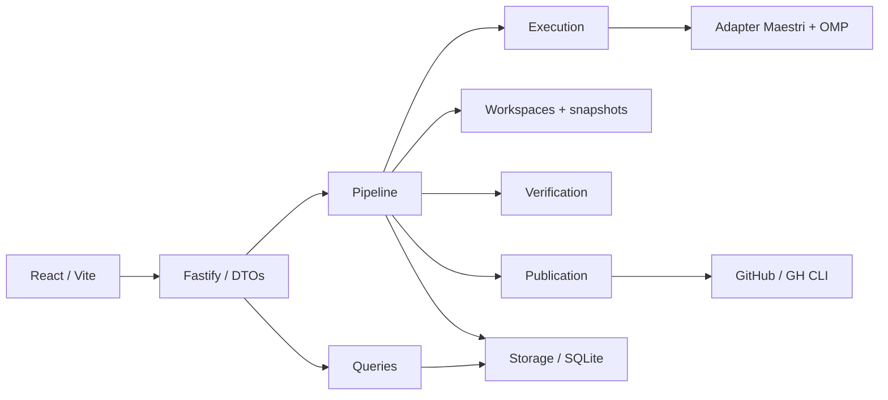

# Nova fábrica de software — especificação de produto e arquitetura

Data: 2026-10-14. Natureza: contrato para implementação nova, não descrição de capacidades já disponíveis. As decisões de produto já discutidas estão consolidadas; os detalhes técnicos recomendados abaixo fazem parte desta proposta para revisão. Não há autorização implícita para provisionar recursos, publicar código, modificar o tracker ou migrar dados.

Este pacote contém três fontes complementares:

- Este documento: produto, jornadas, arquitetura, dados, entrega e aceitação.
- [Integração Maestri/OMP](INTEGRACAO-MAESTRI-OMP.md): contrato executável, início dentro do Maestri, MCPs, processos Windows, workarounds e provas reais.
- [Glossário](GLOSSARY.md): linguagem do produto e definição normativa de Ready.

Implementar os módulos do zero na stack definida, sem importar, copiar ou encapsular controladores e adapters de outros produtos. As orientações deste pacote descrevem os comportamentos exigidos e os problemas a prevenir.

## Etapas de trabalho: ensaio de acesso e desenvolvimento

Decisão de escopo em 2026-10-16: o ensaio responde somente se o LionClaw consegue acessar o Maestri para implementar e testar a fábrica. O workspace canônico é esta pasta; os ensaios ficam em `ensaios-fabrica/`.

| Etapa | Objetivo | Critério de conclusão |
| --- | --- | --- |
| Ensaio de acesso, atual | LionClaw usa Wire para conduzir OMP normal em terminal próprio no Maestri, realizar pequena alteração local e executar um teste. | Alteração e resultado real do teste consultados pelo LionClaw, com evidência e limites registrados. |
| Desenvolvimento da fábrica, futura | Implementar as jornadas e validar a matriz AC/INT deste pacote. | Critérios comprovados no produto implementado. |

A fábrica coordena desenvolvimento. OMP/Maestri e os MCPs configurados pelo operador são componentes confiáveis, usados pelos mecanismos normais suportados. Não implementar ferramentas próprias de arquivos/shell, resolução exclusiva de MCPs, filtragem própria de ambiente ou plataforma de supervisão do runtime.

O plano vigente está em `ensaios-fabrica/casos/validacoes.json`. Revisão independente, correção em rodadas, entrega, cancelamento, reinício, persistência e governança continuam requisitos do produto; sua validação pertence ao desenvolvimento da fábrica e não condiciona o encerramento deste ensaio de acesso. Estudo adicional só se justifica por impedimento concreto à prova de acesso, implementação ou teste. Preservar somente evidências pertinentes ao acesso, alteração e teste, conforme o relatório enxuto dos ensaios; estudos descartados não são backlog. Esta limpeza não inicia agentes ou efeitos externos.

## 1. Problema e objetivo

Checkout compartilhado, lifecycle global de equipe/reserva, transporte restritivo e ferramentas carregadas em ambientes diferentes dificultam mudanças e novas tentativas. A UI deve evitar expor mecanismos rotineiros e pedir confirmações que não correspondem a novas decisões do operador.

O produto novo deve transformar uma issue executável em entrega revisada, com ambiente próprio e acompanhamento simples. Na primeira versão, a fábrica é iniciada exclusivamente por um terminal dentro do Maestri, herdando e validando seu contexto de conexão; OMP é o executor dos agentes. O código pode ser desenvolvido no IDE de preferência do desenvolvedor. Inicialização externa com attach e agentes Eve da Vercel ficam fora deste escopo. O operador pode conversar livremente com o agente; só resultados oficiais e efeitos executados pela fábrica obedecem ao contrato de coordenação.

A finalidade não é eliminar toda verificação: é remover situações perigosas pelo desenho, esconder mecanismos rotineiros e manter provas de integridade onde elas protegem uma entrega real.

### 1.1 Escopo

Incluído:

1. Criar projeto/scaffold e, quando escolhido, remoto e publicação do baseline.
2. Cadastrar repositório existente sem modificar sua pasta.
3. Configurar projeto, perfis e Kanban monitorado.
4. Iniciar explicitamente uma issue ou selecioná-la de Ready.
5. Implementar, verificar, revisar independentemente e corrigir dentro do limite.
6. Entregar ICR, ICR + Commit ou ICR + Commit + PR.
7. Perguntas humanas, cancelamento, interrupção e nova tentativa sem reset operacional manual.
8. Histórico, diffs, evidências e diagnóstico acessíveis.

Fora do escopo:

- Wayfinder, to-spec e to-tickets: pertencem ao sistema anterior da cadeia.
- Merge automático, deploy, decisão automática de produto ou mudança silenciosa de critérios.
- Vários workers, filas distribuídas, várias máquinas executoras da mesma conta ou coordenação global GitHub.
- Sandbox absoluta contra comandos do operador, rede, serviços externos ou processos maliciosos do mesmo usuário.
- Migração de históricos/SQLite/journals do produto antigo.
- Adapter Eve nesta implementação; nenhum SDK ou protocolo Vercel é presumido.
- Editor de Kanban completo, gerenciamento de PIDs pelo operador ou um framework genérico de workflows.

### 1.2 Decisões consolidadas

| Tema | Contrato |
| --- | --- |
| Stack | TypeScript, Node.js LTS, Fastify, React/Vite, SQLite; GH CLI no primeiro adapter GitHub |
| Ambiente inicial | Windows; UI e controlador locais; controlador iniciado por terminal-âncora dentro do Maestri |
| Executor inicial | Maestri apresenta terminal comum; OMP executa agente; fábrica coordena |
| Interação | TUI nativa livre durante trabalho, pergunta e após resultado; sem filtros próprios do compositor |
| Entrega | ICR; ICR + Commit local; ICR + Commit + push + PR; sem merge |
| Trabalho | Clone gerenciado por tentativa; nenhuma adoção automática do checkout do operador |
| Fila | Ready + único responsável igual à conta GitHub autenticada |
| Concorrência | Uma instância executora designada por conta, um trabalho automático ativo inicialmente; várias interfaces não criam workers |
| Configuração | Editável pela UI, persistida e capturada automaticamente por tentativa |
| Falhas | Diagnóstico recuperável não vira impedimento terminal; pergunta humana não requer reset |
| Nova tentativa | Novo ambiente e configuração revisável; histórico anterior preservado |

### 1.3 Critério de produto útil

O percurso normal de uma issue não exige selecionar terminais, executar preflight manual a cada rodada, guardar versão explicitamente, arquivar equipe, liberar reserva ou voltar a Ready para repetir. Toda intervenção visível deve representar decisão real, pré-requisito ausente ou efeito que o sistema não conseguiu confirmar.

## 2. Fontes de verdade e entrada do planejamento

| Informação | Dono |
| --- | --- |
| Issue, critérios, referências de spec e dependências | GitHub Issues |
| Intenção, responsável e posição na fila | GitHub Projects/Issues |
| Repositório, commits, branch e PR | Git/GitHub |
| Tentativa, snapshots de configuração/escopo, referências Git da entrega, resultados e efeitos conhecidos | Banco da fábrica |
| Perfis e padrões de projeto | Configuração persistida da fábrica |
| Templates e contratos dos papéis | Arquivos versionados no produto novo |
| Conversa OMP | Runtime do executor; não é resultado oficial |

O sistema anterior entrega uma issue com título, objetivo/escopo, critérios verificáveis e referências de spec quando pertinentes. Aceitar seção Markdown `Critérios de aceite` ou `Acceptance criteria` com itens de lista; IDs explícitos `ac-N` são preferidos. Sem IDs, atribuir IDs por ocorrência no snapshot da tentativa; textos iguais são ocorrências distintas. Não inferir critérios de comentários livres nem exigir uma ferramenta wayfinder instalada.

Capturar URL, node ID, repositório, número, corpo, digest dos critérios, comentários pertinentes e dependências. Os agentes podem consultar comentários atuais por leitura hospedada, mas o escopo capturado não muda implicitamente. Correção editorial fora dos critérios não deve encerrar trabalho; alteração semântica dos critérios exige decisão humana ou outra tentativa.

Não editar automaticamente checkboxes do corpo da issue: releituras não fornecem CAS remoto e podem competir com o planejamento externo. Publicar resultado e evidências no corpo da PR e, nos modos sem PR, em um comentário identificado da fábrica. Isso é acompanhamento, não fechamento da issue. Um comentário duplicado após resposta perdida deve ser reconciliado por marcador da tentativa.

## 3. Projetos, scaffold e configuração

### 3.1 Cadastro de projeto existente

Informar nome, origem Git (remoto GitHub ou repositório local) e branch-base. Descobrir identidade de remoto por URL/IDs, nunca por nome da pasta. A pasta indicada pode estar dirty: ela é origem de cadastro, não ambiente de execução. Para origem local, clonar histórico commitado; informar que alterações não commitadas não entram na tentativa. Não fazer stash, reset, commit ou limpeza nessa origem.

Cadastro de projeto local sem remoto é permitido. Para iniciar uma tentativa e entregar em qualquer modo (ICR, ICR + Commit ou ICR + Commit + PR), o projeto deve ter remoto GitHub confirmado e GitHub Project configurado, com a issue do repositório associado presente nesse Project. Enquanto esses pré-requisitos estiverem ausentes, o projeto permanece cadastrado e configurável, sem execução ou entrega. Suportar Projects pessoais e organizacionais quando acessíveis pela conta; não limitar implicitamente a um owner/Project do Aula IA.

### 3.2 Scaffold

Formulário: nome, template, destino novo, modalidade. Nome sugere destino, mas caminho é editável dentro da raiz de projetos escolhida pelo operador. Essa raiz é configuração do produto novo, não caminho hardcoded do workspace antigo.

Modalidades:

- Somente local: arquivos do template, Git e baseline Conventional Commit.
- Remoto sem push: anterior + novo remoto GitHub e origin; baseline não publicado.
- Remoto com push: anterior + publicação do baseline na branch-base escolhida.

Owner, nome remoto e visibilidade aparecem somente nas modalidades remotas. Nome remoto não precisa coincidir com nome do cadastro. Conta consultada sugere owner sem sobrescrever edição manual. Uma ação Criar autoriza exatamente o resumo escolhido; sem confirmação duplicada.

Plano automático inclui destino canônico, template/digest, arquivos, efeitos e conta/owner. Revalidar antes de escrever; mudança inicial recusa sem efeitos. Criar diretório exclusivamente, recusar destino existente e escapes por junction/symlink. Não adotar remoto existente por resposta inesperada. Efeitos são registrados antes/depois; criação parcial preserva arquivos e apresenta inspeção do que existe, sem rollback destrutivo ou retry cego.

O scaffold da criação deve fornecer a configuração de engenharia por repositório descrita pela skill **setup-matt-pocock-skills**: tracker GitHub, orientação de documentação de domínio e configuração de triagem quando aplicável, com os apontadores necessários para os agentes. Essa é a referência funcional do scaffold, não um template genérico de aplicação nem instalação indiscriminada de skills.

As skills de referência foram fornecidas em `.agents/skills/` neste repositório. Para implementar o scaffold, o agente deve consultar `.agents/skills/setup-matt-pocock-skills/SKILL.md` e os recursos e skills referenciados por ela para definir a configuração adequada ao projeto. Esta especificação não fixa caminhos, nomes de arquivos ou um layout próprio em substituição à skill. A referência deve permanecer disponível no ambiente de implementação ou nos recursos distribuídos com o produto; nenhum agente deve precisar acessar o workspace usado para elaborar esta especificação.

Nos projetos criados, o scaffold gera apenas a configuração de engenharia e seus apontadores; as skills de referência não são copiadas nem instaladas no projeto de destino. O arquivo de instruções usado pelo scaffold é sempre `AGENTS.md`, criado quando ausente ou atualizado quando existente, preservando seu conteúdo e sem duplicar seções. Essa escolha é fixa, inclusive quando o template contém `CLAUDE.md`, e não exige pergunta ao operador.

O plano de criação apresenta a configuração efetiva antes da ação Criar, sem entrevista duplicada para escolhas já informadas. As regras desta SPEC prevalecem sobre o ritual interativo da skill: escolhas no formulário e no plano, com confirmação única na ação Criar. Preservar as instruções existentes do template e não duplicar seções. A configuração de triagem não substitui a governança Ready/assignee/Project da fábrica nem autoriza criar labels remotas implicitamente. O scaffold também deve ignorar credenciais e arquivos gerados, preservando exemplos versionáveis.

Os recursos necessários devem ser autocontidos e versionados, sem dependência de caminhos pessoais ou da instalação deste workspace. Recurso obrigatório ausente ou template inválido falha antes de criar o destino. Alterar o scaffold não reconfigura projetos existentes. Esta atualização documental não executa o setup.

Criar não abre agentes nem inicia issue. Sucesso mostra projeto, pasta, baseline e remoto/publicação conforme escolhido; Abrir projeto leva à preparação. Scaffold somente local é permitido, mas execução e entrega aguardam a configuração de remoto GitHub e GitHub Project exigida no cadastro.

### 3.3 Configuração

Configuração global: host executor designado, diretórios, integração Maestri, perfis reutilizáveis, defaults de tempo e política de artefatos. MCPs usam a configuração suportada do OMP; a fábrica não mantém um catálogo/resolver paralelo.

Configuração por projeto: origem Git/identidade GitHub, branch-base, Project e IDs de Status, perfis Implementador/Revisor, comandos de checks com cwd relativo, limite de correções, modo de entrega padrão, automação habilitada e ordem na fila.

Perfis contêm executor (`maestri-omp` inicialmente), provider/modelo/esforço exatos e orientação. Não impor classificação obrigatória por labels nem catálogo enorme de especializações na primeira entrega. Labels são contexto; o par de perfis escolhido governa a execução. Usuário pode adicionar orientação por projeto/tentativa sem redefinir critérios.

Toda edição confirma gravação somente após commit local. Usar revisão para duas abas concorrentes; preservar campos em conflito. Não expor revisão numérica como trabalho do operador. Cada tentativa captura defaults efetivos, contratos dos papéis, versões de ferramentas e origem das configurações. Mudanças de defaults não reconfiguram tentativa ativa.

## 4. Fila Ready e responsabilidade

### 4.1 Elegibilidade

Uma issue automática precisa estar aberta, no repositório/Project configurados, com Status Ready e **exatamente um assignee**, igual ao node ID da conta `gh` do controlador. Comparação principal por ID; login serve à apresentação. Bloqueadores abertos impedem seleção, mas não tornam todo o Project indisponível. Draft items e PR cards não são tickets de implementação.

Sem responsável: ignorar. Outro responsável: ignorar. Múltiplos responsáveis: mostrar motivo de inelegibilidade; não escolher um deles. Não autoatribuir no polling. Ready antes ou depois da atribuição produz o mesmo resultado quando a condição completa é observada.

Polling GraphQL com paginação completa dos itens necessários; snapshot atual é suficiente para fila. Não importar o gatilho `ProjectV2ItemStatusChangedEvent` ou depender de captar Backlog → Ready em uma janela temporal. Intervalo inicial recomendado 15 s, configurável com limite e backoff de leitura; não é SLA. API parcial, auth errada ou rate limit não autorizam despacho. Respeitar Retry-After/reset; UI indica consulta degradada.

A seleção automática global consulta somente projetos com automação habilitada. Falha ou configuração incompleta de um projeto bloqueia seus candidatos, sem invalidar candidatos de outros projetos com leitura completa e identidade confirmada. Backoff de projeto fica restrito a ele; falhas compartilhadas de identidade ou mudanças de configuração durante a leitura bloqueiam o despacho. Uma observação global pode ser parcial (`complete=false`) e válida para os candidatos confirmados (`valid=true`); nesse caso, o total global permanece desconhecido e a interface identifica os projetos bloqueados. A habilitação de um projeto exige sua observação completa. Automação do projeto não substitui a habilitação global; a interface explica a pausa global e oferece acesso à fila para habilitá-la.

### 4.2 Consumo e repetição

No banco, deduplicar por projeto/issue e ciclo de Ready observado. Registrar intenção e tentativa antes do lançamento. Uma issue que continua em Ready após tentativa iniciada não é reexecutada por cada polling, restart, falha de mover card ou reordenação. Tentativa falha/cancelada não ganha retry automático.

Novo ciclo automático só é armado após observar a issue fora de Ready e depois novamente elegível em Ready. Transições completas ocorridas enquanto offline não são reconstruídas: uma issue já consumida e vista novamente em Ready permanece consumida; Nova tentativa explícita resolve sem contorcer o quadro. Isso evita prometer exatamente-uma-execução para eventos que a API de snapshot não mostrou.

Ao habilitar automação, apresentar quantidade de issues elegíveis atuais e explicar que serão enfileiradas. Ativar autoriza processar as atuais; pausar impede novos inícios, não cancela tentativa vigente. Retomar conserva consumo e histórico.

Ordenação: campo numérico de prioridade configurável no Project, quando fornecido; depois posição retornada pelo quadro quando houver ordenação documentada; desempate por número/ID. Não prometer ordem visual se a API não a disponibilizar: nesse caso usar número crescente e exibir esse critério. Mudança de prioridade reordena apenas trabalho não iniciado.

### 4.3 Uma instância executora por conta

Separar controlador/worker da UI. Várias abas e clientes consultam a mesma instância, não abrem workers. Um lock de processo por instalação/conta impede segundo processo no mesmo host, independente de porta ou projeto.

Um host é designado para executar aquela conta; outra máquina é cliente, não executor. Na primeira entrega não há mecanismo distribuído para eleger esse host. A UI/instalador devem comunicar a restrição e exigir configuração explícita de host executor. Lock local não impede iniciar outra instalação independente em outro computador: isso é configuração não suportada, não garantia silenciosa. Suporte futuro precisaria de coordenação compartilhada, não labels/comentários como falso mutex.

Contas diferentes podem ter suas esteiras, com um assignee exclusivo escolhendo o destino. Revalidar conta, assignee, Project, issue aberta e Status antes do despacho e antes de publicação. Mudança de responsável em tentativa ativa revoga publicação e solicita cancelamento, conservando trabalho. **Handoff entre contas exige cancelar/encerrar a tentativa anterior antes de atribuir e rearmar Ready**; não há lock atômico de GitHub que garanta transferência concorrente. Nunca autoassumir card em In progress de outra máquina.

Mudança externa de coluna que conflite com a etapa suspende avanço e mostra Divergência do Kanban; não reescrever à força o quadro. Releituras antes/depois reduzem corridas, não fornecem CAS remoto. Exatamente-uma-publicação entre instalações independentes está fora do contrato.

### 4.4 Colunas

Mapear IDs de Project, campo single-select e opções; rótulos são editáveis. Sem criar campos/colunas sem ação explícita.

| Papel da coluna | Uso |
| --- | --- |
| Backlog | Não elegível |
| Ready | Fila elegível |
| In progress | Implementação/checks/correção |
| In review | Revisão independente |
| Delivered | Modo de entrega concluído; não significa merge |
| Done, se existir | Integração/encerramento sob controle humano; fábrica não move automaticamente |

Delivered é o padrão recomendado; projeto pode mapear outro rótulo com a mesma semântica explícita. Aprovação sem publicação completa não move para Delivered no modo PR. Reprovação/impedimento não devolve automaticamente para Ready: conserva coluna e estado técnico no resultado local. Falha de projeção não apaga resultado nem reexecuta trabalho.

## 5. Tentativa, rodada e interação

### 5.1 Início manual

Selecionar projeto/issue, modo e orientação opcional. Autosave tem estados salvando/salvo/erro; Iniciar aguarda save confirmado. Mesmo fluxo interno da fila, sem controlador paralelo. Issue deve pertencer ao projeto e estar atribuída exclusivamente à conta, inclusive no início manual; erro informa como atribuir no GitHub. Ready é exigido para primeiro início; Nova tentativa explícita pode iniciar fora de Ready após verificar origem e ausência de tentativa ativa daquela issue.

Preparação verifica remoto GitHub confirmado, GitHub Project configurado e vínculo da issue a esse Project em todos os modos de entrega, além das dependências exigidas pela tarefa, acesso GitHub, base, template/configuração, executor e ferramentas. Pré-requisito ausente impede o despacho e informa a configuração necessária. Não chama dois providers apenas para aprovar o ambiente antes de cada trabalho: consulta local e handshake efetivo do próprio runtime são usados; autenticação provider será comprovada na chamada real.

Criar tentativa e consumo/ownership de despacho na mesma transação SQLite. Clone/processos são efeitos posteriores com journal; falha não deixa tentativa invisível. Uma resposta HTTP perdida deve ser consultável por request ID; cliente não repete um lançamento para descobrir se deu certo.

### 5.2 Ambientes e versões

Clone independente por tentativa em `<data>/work/<attempt-id>/implementation`; branch local `factory/<issue-number>/<attempt-id>`, base fixa por SHA. Sem hard links/alternates que dependam da pasta do operador; não copiar dirty de origem. Sem atualização silenciosa da base no meio da tentativa.

Ao concluir a implementação, o Implementador encerra as escritas e aguarda o término de ferramentas e processos próprios que alteram o produto antes de entregar o resultado oficial. O controlador confirma a conclusão da passagem e então produz snapshot imutável de conteúdo e evidências fora do clone mutável. Checks e revisão começam somente após a captura. A captura é uma versão imutável mantida no Git, com referência protegida contra coleta enquanto a entrega for necessária, sem publicação remota implícita. Ela inclui alterações tracked e untracked não ignoradas pertinentes à entrega, exclusões, renames e modos de arquivo. O banco guarda base SHA, referência da versão e apenas hashes/metadados estritamente necessários; não guarda conteúdo de arquivos nem cópia do índice. A preparação dessa versão não altera o índice do checkout de implementação. Usar Git `-z` para nomes; não parsear `old -> new` ou linhas. Erro Git/leitura/índice conflitante não produz hash aprovável. Arquivos especiais/submodules/LFS devem ser suportados com conteúdo exato e checks apropriados ou receber diagnóstico de incompatibilidade antes da revisão; não fingir uma entrega completa.

Ignored gerados não pertencem à entrega; mostrar arquivos novos ignorados quando o agente afirma alterá-los. Segredos conhecidos não devem ser coletados/publicados automaticamente. Manifesto e diff têm identidade `deliveryVersion` por conteúdo; HEAD sozinho é insuficiente para ICR.

Revisor recebe clone independente da base com snapshot aplicado e dados da issue/achados; não recebe conversa do Implementador. Checks podem criar caches ignored. Alteração de produto pelo Revisor invalida aquele parecer; não aceitar correção feita pelo Revisor como implementação independente. Snapshot permanece disponível após processos terminarem.

Após entregar, o Implementador não modifica o produto durante checks, revisão ou publicação. A conversa pode permanecer disponível, sem filtros no compositor ou autorizações por arquivo. Reprovação abre uma rodada de correção explícita: o Implementador volta a escrever, conclui a correção e entrega uma nova versão para captura, checks e revisão independente. Aprovação segue para a entrega no modo escolhido, sem etapa de edição contínua ou ação Reavaliar alterações.

A captura ocorre entre o encerramento das escritas da passagem e o início dos checks. Não exigir consentimento por arquivo nem adotar vigilância contínua de modificações como condição de publicação. Alteração externa durante a captura é falha técnica de captura: preservar o trabalho e permitir repetir a captura, sem reiniciar o Implementador. A coordenação das escritas próprias não constitui bloqueio de filesystem contra programas externos. Materializar o snapshot aprovado em clone privado de publicação e criar commit/tree a partir dele; nunca coletar novamente o checkout de implementação para publicar.

### 5.3 Estados

Evitar flags contraditórias que a UI precisa reconciliar. Registro da tentativa tem etapa explícita e resultado separados:

- Fases: `preparing`, `implementing`, `verifying`, `reviewing`, `publishing`, `finished`.
- Suspensão opcional: decisão humana necessária, dependência/configuração indispensável que exige intervenção externa, divergência externa ou acompanhamento perdido. Dificuldade operacional recuperável não suspende a tentativa.
- Resultado final: `delivered`, `rejected`, `failed`, `cancelled`, `interrupted`.
- Revisão: `pending`, `approved`, `rejected`, sempre vinculada à deliveryVersion.
- Publicação: por efeito, não booleano global.
- Limpeza: `pending`, `complete`, `uncertain`; não muda aprovação histórica.

Uma suspensão pertence a uma passagem/versão, com motivo e ação. Pausar fila não pausa a tentativa. Pergunta humana mantém fase e não consome correção. Tempo de espera humana não conta como tempo de execução do agente; TTL da pergunta e limite de custo são separados e visíveis. Defaults recomendados: 30 min por passagem ativa, sem cancelamento automático por mero silêncio do terminal; expiração registrada e cancelamento técnico comprovado.

Rodada inicial 1; limite de correções padrão 2, editável de 0 a 5. Reprovação abre correção no mesmo ambiente da tentativa com contexto estruturado; mesma conversa do Implementador pode continuar se runtime estiver acompanhado. Nova revisão sempre usa sessão independente. Perda de sessão do Implementador não inicia outro processo escondido: oferecer nova passagem com contexto estruturado quando explicitamente solicitado ou nova tentativa; primeira entrega prioriza nova tentativa simples.

### 5.4 Resultados

Extensão OMP registra `execution_complete` e `execution_question`. Não exigir `execution_accept` do modelo: autorização é o despacho confirmado pelo controlador/runtime. Não portar `execution_block` como saída genérica.

Schema do Implementador: resumo, arquivos declarados, evidências para todos os criterionIds capturados, checks declarados e respostas aos achados abertos na correção. Arquivos efetivos/diff são calculados pelo controlador, não autoria presumida por declaração. Checks obrigatórios do projeto são executados também pelo módulo de verificação sobre a entrega; relato do modelo não substitui execução.

Schema do Revisor: verdict enum, motivo, evidência/verdict de todos os criterionIds, checks e achados `{findingId, criterionIds, problem, evidence, expectedResult}`. Achados gerais podem usar `criterionIds: []` com categoria técnica explícita; não inventar vínculo para encobrir problema transversal. Aprovação exige todos os critérios aprovados, nenhum achado novo impeditivo e todos os anteriores resolvidos independentemente. Reprovação deve ter problema concreto, não string genérica. Cobertura exata/IDs únicos, não matching textual.

IDs execution/passage/session/round/role/deliveryVersion são vinculados pelo transporte; o modelo não escolhe identidades privadas. Primeiro resultado válido é persistido antes de ACK; payload malformado não ocupa cache. Repetição idêntica vigente recebe mesmo recibo; conflito recebe erro específico. Fim de turno, transcript, texto contendo approved ou retorno de `maestri ask` não são resultado.

### 5.5 Perguntas e erros recuperáveis

O despacho autoriza o agente a resolver dificuldades operacionais dentro do escopo e do ambiente da tentativa, respeitando seu papel. Preparar ou atualizar índices e caches próprios, corrigir argumentos/configuração local e tentar outra abordagem compatível não exigem nova permissão. Essa autonomia não autoriza publicação, alteração do ambiente do operador, mudança de escopo ou efeitos irreversíveis ainda não autorizados. O Revisor mantém a restrição de não alterar o produto.

Pergunta formal apresenta a decisão necessária, contexto e alternativas, associada à tentativa/passagem. Orientações do agente reservam perguntas para decisões de produto, escopo e efeitos ainda não autorizados; manutenção rotineira deve ser resolvida autonomamente. Credencial ausente ou impossibilidade técnica recebe diagnóstico concreto, sem pedido de permissão para bloquear.

O controlador valida formato e vínculo de `execution_question`, não classifica semanticamente a justificativa nem rejeita uma pergunta por um detector de manutenção. Não criar estado Aguardando permissão de bloqueio. Responder continua na mesma passagem; conversa e ferramentas permanecem normais.

Investigar o erro, usar ferramentas reais e corrigir a causa recuperável. Se uma ferramenta auxiliar permanecer indisponível, usar evidência alternativa suficiente, como código atual, sem alegar ter executado a ferramenta. Requisito obrigatório de verificação não pode ser dispensado. Se o cumprimento ficar tecnicamente impossível, registrar falha concreta, ações tentadas e requisito afetado, preservar trabalho/evidências e oferecer recuperação; não converter impossibilidade técnica em pergunta de autorização. Não exigir N tentativas arbitrárias nem repetir operações de efeito desconhecido sem reconciliação.

Aguardando resposta pausa avanço automático e publicação, não TUI, comandos, ferramentas ou conversa. Responder pelo painel entrega à mesma passagem acompanhada, com correlação e ACK; texto digitado no terminal não resolve implicitamente a pergunta formal. Terminal pode exibir a pergunta e uma action suportada de resposta explícita, usando o mesmo contrato, sem parser de conversa livre.

Mudança de escopo vai para GitHub e requer nova tentativa; orientação dentro do escopo pode continuar. Resultado enviado durante pergunta é recusado com diagnóstico corrigível, sem matar agente. Resposta humana com entrega incerta mantém pausa e disponibiliza consulta do recibo antes de outro envio; não retry automático. Cancelar pergunta/tentativa é opção acessível, nunca reset de equipe.

## 6. Modos de entrega e efeitos remotos

Todos os modos exigem remoto GitHub confirmado e GitHub Project configurado, com a issue associada. ICR e ICR + Commit mantêm as alterações de código locais; a exigência de remoto e Project não autoriza push nesses modos. Revalidar esses vínculos antes de concluir a entrega.

| Modo | Sucesso |
| --- | --- |
| ICR | Snapshot aprovado + diff/evidências + ambiente acessível, sem commit de entrega |
| ICR + Commit | Anterior + commit local na branch gerenciada, sem push |
| ICR + Commit + PR | Commit + push daquela branch + PR aberta, sem merge |

Modo é capturado no início; escolher PR autoriza o push necessário. Nenhuma confirmação repetida entre esses efeitos. Aumentar modo de uma tentativa encerrada é uma nova ação de publicação explícita, com resumo e revalidações, não reimplementar trabalho aprovado.

Controller cria Conventional Commit com referência da issue/tentativa e diff aprovado, em ambiente privado de publicação. Não incorporar arquivos do operador, caches, artefatos de evidência ou mudanças manuais posteriores. Nada de force-push. PR direciona branch-base do projeto e inclui escopo, base/deliveryVersion, checks, verdict, pendências não impeditivas, attemptId e referências. Não usar palavras de auto-close por padrão; abrir PR não fecha issue nem marca Done.

No-op pode ser entrega legítima (critério já atendido ou tarefa de verificação), desde que revisão explique evidências. Commit vazio não é fabricado; modo Commit registra efeito `not_applicable`; modo PR sem delta não cria PR vazia, encerra como entrega sem alterações e explica por que aquele efeito não se aplica.

### 6.1 Journal e reconciliação

Cada efeito tem operationId, intenção durável, parâmetros sem segredos e estado `not_requested`, `not_started`, `running`, `confirmed`, `failed_known`, `unknown` ou `not_applicable`. Resposta recebida não é único critério de confirmação: reler SHA remoto/PR por base/head/attempt marker.

Persistir intenção antes de commit/push/PR/Status/comentário. Falha de banco impede o próximo efeito. Timeout após enviar mutação é unknown; consultar antes de reenviar. Não fazer rollback automático de remoto, commit ou trabalho.

Concluir publicação executa somente efeitos pendentes após reconciliação: commit por tree/parent/operationId, push por ref e SHA, PR por head/base/repositório e marcador. PR existente diferente não é adotada por nome parecido. Rate limit é espera técnica, não reprovação de implementação. Fail de publicação conserva aprovação, diff, commit confirmado e artefatos. Não reexecutar Implementador por falha de PR.

Elegibilidade de bytes e autorização de publicar agora são consultas distintas. Gate agora exige: versão aprovada, passagem de produção concluída, nenhuma pergunta/cancelamento ou interrupção ainda não reconciliada, conta/assignee/Project atuais, modo autorizado e nenhum efeito desconhecido incompatível. Após restart, a ação explícita Concluir publicação cria uma nova autorização delimitada para o snapshot histórico, depois de reconciliar recursos e efeitos; não restaura autorização do agente. O conteúdo usado na publicação é sempre o snapshot aprovado, não o clone corrente.

## 7. Cancelamento, restart e nova tentativa

Cancelar impede imediatamente novos avanços e efeitos de publicação da fábrica e solicita parada dos recursos que ela iniciou. Resposta 202 informa Cancelamento solicitado, não Tudo parado. O adapter acompanha também o lançamento pendente conhecido; se um terminal retornar depois, registra e solicita sua parada. Falta de confirmação é exibida como limpeza incerta, sem apagar arquivos ou anunciar parada completa. Não há garantia de contenção de todos os daemons, brokers ou descendentes possíveis de ferramentas.
Cancelar não desfaz uma requisição remota já enviada. Se push/PR/Status terminar depois da solicitação, registrar o efeito efetivamente confirmado e impedir os próximos; mostrar efeitos ocorridos, sem anunciar cancelamento como rollback. A reconciliação permanece disponível para efeitos desconhecidos, mas não autoriza completar automaticamente publicação de tentativa cancelada.


Não bloquear toda fábrica por um ambiente residual: preservar/quarentenar tentativa antiga e evidências, permitir nova tentativa em outro clone quando separação dos efeitos da fábrica estiver comprovada. Runtime antigo deve perder canal/autoridade de resultado e publicação. Um terminal comum ainda tem permissões do operador: não garantir impossibilidade de ações externas manuais; apresentar esse limite.

Reinício converte trabalho não terminado em interrupted, revoga tokens antigos e não retoma conversa/provider. Reconciliar automaticamente fatos consultáveis e registrar limpeza pendente; abrir UI não faz restart/recruit. Histórico, snapshot e efeito confirmado sobrevivem. Nova tentativa é ação normal: copia parâmetros revisáveis, usa base atual, issue atual e outro ambiente, sem reaproveitar alterações/sessão anteriores nem exigir Ready novamente.

Concluir publicação de snapshot aprovado pode continuar após restart com ação explícita e checks atuais; não reconstituir sessão de agente. Tentativa cancelada/interrompida antes da aprovação não vira elegível. Artefatos não são apagados porque cancelamento foi solicitado. Remoção explícita de ambiente somente após prova dos recursos próprios e com indicação do que será perdido; histórico/resultados não são apagados junto por acidente. Sem limpeza automática destrutiva de ICR não exportado na primeira entrega.

## 8. Arquitetura e organização do repositório novo

### 8.1 Forma

Monólito modular. Um processo controlador Fastify contém scheduler/worker assíncrono; agentes usam runtime OMP normal, que gerencia seus MCPs. A fábrica acompanha os recursos que inicia, sem assumir contenção geral. Operações HTTP não esperam a duração da tentativa. Sem broker, microserviços, event sourcing ou repository genérico.

TypeScript strict; Node 24 LTS inicialmente, dependências com lockfile. Código de produção compilado, não depender de type stripping/experimental flags para instalação. React/Vite é cliente, não dono da orquestração. SQLite com driver transacional e migrations versionadas. Fastify expõe DTOs e schemas; UI não importa modelos internos do runtime.

### 8.2 Módulos profundos

| Módulo | Interface de negócio | Conhecimento privado |
| --- | --- | --- |
| projects | Criar/cadastrar/configurar projeto e planejar scaffold | Templates, caminhos, etapas de criação |
| github | Consultar trabalho/identidade, projetar acompanhamento e publicar PR | GH CLI, GraphQL, paginação, rate limit e respostas parciais |
| pipeline | Iniciar/cancelar/repetir, decidir rodadas e perguntas | Ordem dos efeitos, transições e snapshots de configuração |
| workspaces | Preparar tentativa, capturar entrega e materializar revisão/publicação | Clone, Git -z, manifesto, isolamento de caminhos |
| execution | Iniciar passagem, observar, responder pergunta e encerrar | Adapter Maestri/OMP, processos, sockets, bootstraps e runtime |
| verification | Executar checks de uma entrega e agregar resultado | Subprocessos de teste, timeouts, artefatos |
| publication | Avaliar publicação atual e concluir efeitos do modo | Commit/tree/ref/PR e reconciliação |
| storage | Operações atômicas de configuração/tentativa/resultados/efeitos | SQL, locks, migrations e CAS |
| queries | Resumo/lista paginados e detalhe da tentativa | Projeções de leitura sem autoridade |

Interfaces pequenas devem ocultar ordem de chamadas. Só storage escreve SQL; só execution conhece Maestri/OMP; só github executa GH; só workspaces conhece representação Git do ambiente. pipeline recebe módulos por composição, não localiza binários.
Direção de dependência: HTTP chama interfaces de projetos/pipeline/publication/queries; pipeline coordena execution/workspaces/verification/github/storage; publication usa workspaces/github/storage; queries só lê storage/artefatos. Os adapters não importam HTTP/React nem chamam pipeline por referência global: entregam eventos/decisões ao caller pela interface. Dependências entre módulos são explícitas na composição; nenhum módulo genérico `utils` vira depósito de regras.




Estrutura recomendada, nomes de operações abaixo são contrato proposto, não símbolos existentes:

```text
apps/
  controller/src/
    main.ts                   # composição, configuração e shutdown
    http/                     # rotas Fastify, autenticação local, DTOs
    modules/
      projects/
      github/
      pipeline/
      workspaces/
      execution/
        index.ts              # interface pública, não reexports de internos
        adapters/maestri-omp/  # única implementação de produção inicial
      verification/
      publication/
      storage/
        migrations/
      queries/
  web/src/
    app/                      # roteamento/layout
    features/projects/
    features/operation/
    features/attempts/
    features/settings/
packages/
  contracts/                  # DTOs/eventos/schemas compartilhados, sem IO
resources/
  roles/                      # Implementador/Revisor versionados
  templates/                  # scaffold autocontido
tests/
docs/
  architecture/
  integration/
  operation/
```

Testes de módulo ficam junto ao módulo quando usam seam interna; `tests/integration`, `tests/acceptance` e `tests/fixtures` compõem a interface de negócio. Não criar package por classe nem uma camada adapter/use-case/repository por endpoint. Exportar só interface necessária; imports internos de outro módulo são proibidos por regra estática de dependência.

### 8.3 Interface do executor

Contrato conceitual:

- `startPassage(request, signal) -> PassageHandle`: só resolve como ready após handshake efetivo; criação parcial tem recibo identificável.
- `observe(handle, cursor?) -> eventos`: ordenação/sequence e dedup definidos, eventos técnicos sanitizados.
- `getResult(handle)`: lê resultado durável aceito, inclusive se chegou antes do consumidor.
- `answerQuestion(handle, questionId, answer, operationId)`: entrega correlacionada à mesma passagem, retorna recibo.
- `cancelAttempt(attemptId) -> processo de encerramento e recibos`: idempotente por operação, inclui lançamentos pendentes.
- `interactionSurface(handle)`: referência tipada terminal inicialmente, não PID/socket/token.

O módulo execution é adapter-neutral. SessionId, PID, Maestri terminal ID, Job, códigos de erro, IDs de correlação, recibos e fatos brutos de diagnóstico são detalhes privados do backend, disponíveis para os agentes e para a operação interna. Não os mostre ao operador em mensagens, painéis de suporte ou campos de entrada manual; identificadores necessários à correlação podem ser mantidos internamente pela interface sem serem renderizados. A UI apresenta somente estado, causa e próxima ação em linguagem do operador. Adapter precisa declarar capacidades e limites; Eve futuro só será desenhado após pesquisa de seu SDK. Não criar simulação Eve nem usar igualdade de métodos como prova de substituibilidade.

Eventos úteis: passage-ready, progress, question-raised, question-answer-receipt, result-accepted, tracking-lost, cleanup-updated. Transcript completo não é necessário para manter resultados. Fila humana paralela e interceptação de mensagens nativas não pertencem à interface.

### 8.4 Persistência

Tabelas orientadas a consultas/operações reais, não tudo em chave JSON compartilhada:

- accounts/factory_settings: host designado e configuração local, sem tokens GitHub.
- projects/project_revisions: origem, base, Project e padrões versionados.
- attempts: issue, base, modo, etapa, resultado, cancelamento e configuração capturada.
- rounds/passages: papel, contexto, resultado, pergunta e vínculos.
- deliveries/reviews/checks: referências Git e hashes/metadados necessários, julgamento e prova por versão.
- questions: estado, resposta e recibo de entrega.
- effects: intenção/reconciliação por operationId.
- queue_consumptions: ciclo observado/consumo deduplicado.
- resources: ownership/estado de cleanup e referências privadas protegidas.
- events/artifacts: histórico de eventos sanitizados e arquivos externos por checksum.

O workflow coordena desenvolvimento; não é backup do projeto. Git é a fonte do conteúdo versionado. Persistir apenas configuração, critérios, resultados, evidências pertinentes e estado operacional. Para identificar alterações, guardar referências Git e hashes/metadados estritamente necessários. Não copiar checkout, índice Git, arquivos ignorados ou caches para banco, JSON, Base64 ou snapshots auxiliares, inclusive em arquivos externos. Não preservar esse desenho por compressão, deduplicação, cache ou outra tabela. Clones de trabalho, revisão e publicação são ambientes operacionais Git, não cópias serializadas para histórico; snapshots de configuração e critérios não contêm arquivos do projeto.

Evidências pertinentes, como logs de checks e capturas de UI, podem ficar em `<data>/artifacts/<attempt-id>`; o banco conserva referências, checksums, tamanho e relações. Essa pasta não armazena cópias do projeto ou do índice. Listagens, histórico e polling consultam resumos sem carregar ou serializar conteúdo do projeto; diff e evidências são carregados sob demanda no detalhe. Durabilidade: resultado e efeito commitados antes de confirmação; integridade de arquivo é conferida quando consultado/publicado. Missing artifact vira diagnóstico, não fallback vazio.

Operações atômicas principais: criar tentativa/consumir intenção, aceitar resultado com unique passage, gravar review por deliveryVersion, registrar decisão/recibo, atualizar efeito com versão, finalizar/cancelar. Nenhum SQL/lock privado no HTTP/executor. Transactions curtas; nunca segurar transaction enquanto espera provider/GitHub. Falha de escrita tem consequência explícita e nenhuma confirmação falsa.

Snapshot de histórico não restaura autoridade. Secrets efêmeros fora do banco, ACL local restritiva; sessões OMP e caches normais não são dados oficiais da fábrica. Migrations recusam banco mais novo/desconhecido sem substituir por vazio. Export/restore de banco é procedimento futuro separado; não anunciar backup de projeto pelo simples uso de SQLite.

### 8.5 HTTP e segurança local

Fastify ligado a loopback. Rotas versionadas `/api/v1`, contratos JSON Schema comuns; GET sem efeitos de despacho. Mutações exigem application/json, sessão local/token CSRF e Origin local quando browser. Token e bootstrap entregues sem URL/logs; CORS fechado. Binding externo não suportado sem autenticação/TLS próprios.

Grupos: projects/settings, scaffold plans/creations, queue/pause/resume, attempts/start/cancel/retry, questions/answer, deliveries/diff/artifacts, publication/complete, integration/diagnostics. Request ID/idempotency para ações com efeitos; versão/ETag para edição concorrente. Eventos SSE de estado com Last-Event-ID e resync; não WebSocket de terminal falso. Recarregar não repete POST. URLs não carregam credenciais ou conteúdo inteiro de prompt.

Uma interface em outra máquina deve acessar uma conexão autenticada explicitamente provida (por exemplo túnel autorizado ao controlador loopback); não abrir porta pública nem fingir que loopback é acesso remoto pronto. Clientes nunca recebem bootstrap Maestri/provider. Proxies, tunnels e deployment remoto não são provisionados pela primeira entrega.

## 9. Experiência de uso

### Projetos

Catálogo, Criar, Conectar e configuração. Separar projeto local de GitHub Project visualmente. Wizard curto com plano junto à ação. Não exibir detalhes técnicos, IDs internos, códigos brutos ou fatos de diagnóstico; mensagens de erro explicam o problema e a próxima ação em linguagem do operador. Erro de consulta de catálogo não apaga falha de save nem se confunde com sucesso de criação.

### Operação

Conta/host executor, esteira ligada/pausada, tentativa ativa, próximas issues elegíveis e entregas/impedimentos recentes. A fila é projeção do GitHub, não editor paralelo de prioridades. Ações principais Iniciar, Pausar esteira e Abrir tentativa. Mostrar próxima ação, não gerações, reservas ou vários eixos de navegação.

### Tentativa

Issue, modo, etapa/rodada, progresso, resultado, diff, checks, review, commit/PR e pergunta pendente. Ações conforme estado: Abrir terminal/pasta, Responder, Cancelar, Nova tentativa, Repetir captura em caso de falha técnica, Concluir publicação. A UI mostra resultados e orientações úteis ao operador; integração, recibos, IDs, códigos e fatos técnicos permanecem no backend para diagnóstico pelos agentes. Nenhum reset de equipe/liberação de reserva.

### Requisitos de UI

Desktop/mobile, teclado, foco visível, nomes acessíveis computados, contraste/zoom medidos. Mensagens de save/polling não interrompem leitura histórica nem mudam seleção. Contexto de projeto/tentativa persistido na URL; resumo atual e detalhe histórico distintos. Conteúdo carregando/falha/vazio tem ação clara. Diagnósticos na UI informam causa e próxima ação em linguagem do operador; detalhes técnicos, códigos brutos, IDs de correlação, recibos e fatos de diagnóstico ficam no backend e não são apresentados ao usuário. Campos locais preservados em conflito; sem retry automático de criação/start. Teste visual usa exclusivamente Playwright MCP/Chrome conforme anexo.

## 10. Desenvolvimento, aceitação e evolução

### 10.1 Sequência de fatias completas

1. Conectar repositório + início manual + checkout próprio + OMP nativo/resultado + checks + revisão + ICR consultável. Exercitar pergunta, cancelamento em lançamento/trabalho e nova tentativa.
2. Snapshot privado de publicação + commit + push/PR autorizados e reconciliação de resposta perdida. Não entregar só botão/enum sem efeitos reais.
3. Fila Ready por assignee, consumo durável, pause/resume e projeção Kanban, usando a mesma operação start.
4. Scaffold local/remoto e cadastro com plano/revalidação/efeitos parciais.
5. Jornadas UI finais, diagnóstico e inicialização pelo terminal Maestri, documentação e critérios cruzados.

A ordem é dependência de verificação, não autorização para omitir modos/scaffold da entrega especificada. Cada fatia termina com percurso funcional; não criar todos os abstractions/stubs primeiro. Mudança estrutural deve reduzir lugares necessários para mudar uma capacidade, não apenas tamanho de arquivo.

### 10.2 Provas por superfície

Vitest para decisões determinísticas; Fastify inject/HTTP, SQLite/Git temporários para contratos; Maestri/OMP/provider real para o percurso e Playwright MCP/Chrome para UX. Suíte padrão não recruta terminais nem chama provider/rede; ensaios reais têm opt-in e custo explícito.

Validar primeiro o percurso vertical. Para cancelamento, dois cenários representativos: inicialização e trabalho com processo filho. Não exigir matriz em cada instante, observador externo de crash, inventário individual de handles ou ensaios exaustivos de troca de modelo/sessão e eventos tardios antes do produto. Ao perder acompanhamento, interromper coordenação automática, preservar trabalho e permitir nova tentativa; testar o comportamento implementado. Revisar riscos e achados relevantes e o percurso integrado, não cada alteração documental com outro agente. Relatar falhas e limites sem fabricar sucesso.

### 10.3 Matriz de aceitação

| ID | Cenário obrigatório | Observação de conclusão |
| --- | --- | --- |
| AC-01 | Projeto existente dirty | Cadastro e clone da base sem alterar bytes/índice/HEAD do operador |
| AC-02 | Scaffold nas três modalidades | Configuração setup-matt-pocock-skills presente: tracker GitHub, regras de domínio, seção Agent skills e triagem somente quando aplicável; recursos empacotados sem dependência de skill pessoal, sem executar setup interativo ou instalar skills; plano sem efeitos e efeito escolhido confirmado, nenhum agente iniciado |
| AC-03 | Criação parcial/conta alterada | Efeitos preservados, nenhuma repetição/adoção destrutiva |
| AC-04 | Defaults e duas abas | Conflito preserva edição; tentativa captura escolhas antigas sem alteração retroativa |
| AC-05 | Início manual | Cadastro/scaffold local sem remoto permitido; ausência de remoto GitHub, Project ou vínculo da issue impede início em todos os modos; com pré-requisitos, um request cria uma tentativa/clone e resposta perdida é consultável sem novo despacho |
| AC-06 | Implementação real | Agente cria artefato e check; fábrica observa resultado durável, checks executados |
| AC-07 | Revisão independente | Outro runtime e snapshot; critérios/achados exatos; alteração pelo Revisor invalida parecer |
| AC-08 | Correções | Rodada 1, retorno automático dentro do limite, última correção revisada, esgotamento preserva pendências |
| AC-09 | ICR | Diff/artefatos disponíveis após processo terminar; sem commit de entrega |
| AC-10 | Commit | Tree corresponde ao snapshot aprovado, SHA local, sem push |
| AC-11 | PR | Ref/SHA remoto e PR confirmados; sem merge, auto-close ou Done |
| AC-12 | Efeito remoto incerto | Reconciliação não duplica PR/commit nem reimplementa código |
| AC-13 | Encerramento e captura da entrega | Escritas próprias terminam antes da captura; checks/revisão usam snapshot fixo; correção exige nova rodada/captura; publicação usa versão aprovada sem consentimento por arquivo ou vigilância contínua do clone |
| AC-14 | Autonomia e pergunta | Orientação permite manutenção própria; pergunta vinculada recebe resposta na mesma passagem, sem classificador semântico; falha técnica preserva trabalho; conversa/ferramentas livres |
| AC-15 | Erro de tool recuperável | Chamada inválida seguida de correção, sem block terminal automático |
| AC-16 | Cancelamento representativo | Cancelar na inicialização e durante trabalho com filho; avanço/publicação interrompidos, recursos conhecidos recebem parada e ausência de confirmação é informada sem apagar trabalho |
| AC-17 | Nova tentativa | Outro clone/processo, origem/artefatos anteriores preservados, sem reset/liberação/Ready obrigatório |
| AC-18 | Restart | Histórico/resultado/efeitos preservados, tokens antigos recusados, sem restore de sessão |
| AC-19 | Fila | Ready+assignee único; ocupado/offline não perde candidatos; múltiplos assignees não executam |
| AC-20 | Deduplicação | Polls/restart/resposta perdida/Ready residual não geram outra tentativa; retry explícito funciona |
| AC-21 | Instância/identidade | Segundo processo mesmo host recusado; várias UIs usam worker único; mudança de conta pausa despacho |
| AC-22 | Troca de responsável/Status | Revoga publicação; nenhum takeover de In progress; handoff documentado |
| AC-23 | MCPs | MCP necessário funciona no runtime pelo gerenciamento normal do OMP, com descoberta e chamada real; não exigir exclusividade de servidores, resolver próprio ou ambiente mínimo por servidor |
| AC-24 | UTF-8/frames | Português/emoji fragmentados conservados; malformed/oversize/EOF têm diagnóstico e encerram esperas |
| AC-25 | Inicialização dentro do Maestri | Controlador iniciado pelo terminal-âncora com contexto herdado e validado; TUI e ownership confirmados; sem attach externo |
| AC-26 | Cleanup | Recursos conhecidos iniciados pela fábrica recebem parada, recursos manuais não são alvos; confirmação ou incerteza explícita, sem alegar ausência global de processos nem apagar arquivos com parada incerta |
| AC-27 | UI | Quatro percursos e três modos, conflito/save/polling, desktop/mobile/teclado e limites visuais; nenhum detalhe técnico bruto, ID interno, código, recibo ou fato de diagnóstico é apresentado ao operador |
| AC-29 | Persistência e desempenho | Com caches e arquivos ignorados volumosos, medir e registrar tamanho persistido (banco e artefatos auxiliares) e latência de listagens, histórico e polling antes/depois; aumentar esses arquivos não aumenta conteúdo persistido nem payloads, e essas consultas não leem ou serializam conteúdo do projeto; entrega continua identificada e recuperável pelo Git |
| AC-28 | Manutenção | Mudança de executor/MCP sem SQL/UI internos; módulos respeitam imports e contratos; novos checks não alteram lifecycle |

Aceite completo exige a matriz e os casos INT revisados do anexo. Número de testes ou encerramento de issue não equivale a conclusão. Evidências reais devem comprovar o percurso implementado; limitações de runtime não criam automaticamente novos requisitos de harness. A governança do Kanban da seção 4, os modos de entrega e a proteção dos bytes aprovados/publicação permanecem integralmente mantidos.

## 11. Orientações de implementação

- Criação: explicitar modalidades, planos e efeitos; usar templates autocontidos, sem depender de skill pessoal do operador.
- Início e rodadas: capturar snapshot e cobertura dos critérios; usar ambientes próprios, sem reserva global, bloqueio genérico de permissões ou adoção de checkout dirty.
- GitHub: usar IDs estáveis, revalidar estado remoto, paginar itens e organizar fila por assignee. Não editar corpo da issue por falta de CAS remoto.
- Runtime Maestri/OMP: vincular identidade e canais à passagem; manter terminal normal e ferramentas de trabalho disponíveis.
- MCPs: usar configuração e lifecycle suportados do OMP; conferir ferramenta necessária com chamada útil, sem resolver paralelo, exclusividade ou launcher sanitizador próprios.
- Integração: conferir perfil efetivo, resultados vinculados e cancelamento representativo; ao perder acompanhamento, interromper coordenação e preservar trabalho. Usar transporte suportado e UTF-8 correto, sem matriz exaustiva de runtime como pré-requisito.

Registrar as versões efetivas de Maestri, OMP e servidores MCP nos ensaios de integração. Orientações documentais e ajuda CLI não comprovam execução de provider, publicação GitHub ou aceite visual; essas evidências devem ser produzidas pelos critérios de aceite.
