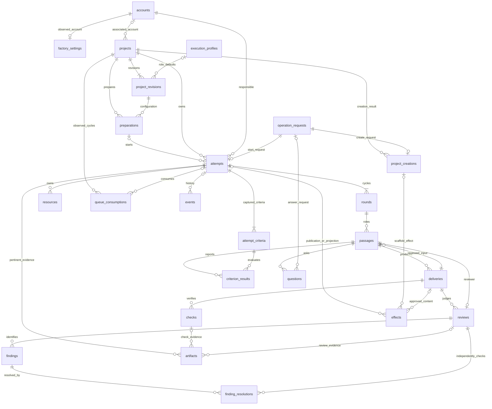
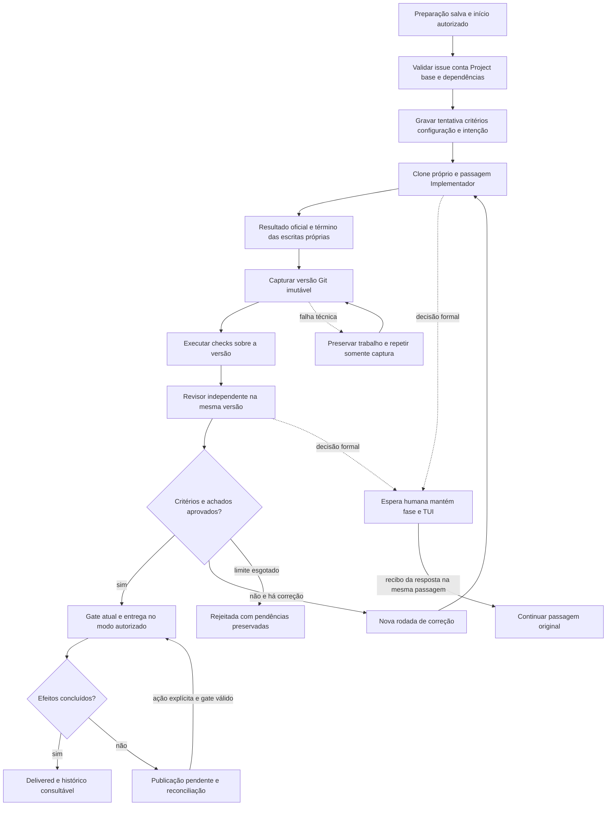

# SPEC - Nova fábrica de software
> Gerado automaticamente pelo Development Pipeline 2.0. Fonte de verdade para implementacao.

## 1. Resumo do Produto

**Correção intencional autorizada, esclarecida pelo usuário em 16/10/2026:** o Login surgiu no design sem ter sido solicitado. C-02 determina sua retirada e a abertura direta na Principal. Diferenças visuais, de rotas, contrato e hashes causadas por essa implementação são esperadas; não são regressão, não exigem restaurar Login ou repetir a autorização e não bloqueiam a continuidade. A referência de implementação é a Principal conciliada com C-02 e F-01–F-05. Preservar os registros do lock original como histórico, sem simular sua atualização. A causa da divergência de hashes já observada antes de editar o HTML continua não demonstrada; ela não deve ser confundida com a correção autorizada.

**Problema — texto do PRD:** “O problema atendido é a coordenação manual de sessões, ambientes, verificações, revisão e recuperação. O produto deve preservar a pasta do operador, usar um ambiente próprio por tentativa, identificar o conteúdo aprovado por referência imutável no Git e tornar visíveis decisões, falhas, efeitos incertos e ações de recuperação. Uma conversa ou uma compilação concluída não comprova entrega.”

**Público-alvo — texto do PRD:** “Profissional que conduz desenvolvimento por issues executáveis no GitHub e usa Maestri/OMP no Windows. A conta GitHub autenticada pelo contexto do controlador determina quais issues podem ser executadas; a sessão técnica do navegador não cria identidade de usuário.”

**Pitch/resumo — texto do PRD:** “A Nova fábrica de software é uma esteira local que transforma issues executáveis do GitHub em entregas implementadas, verificadas e revisadas independentemente. O operador cadastra ou cria um projeto, configura perfis e checks e inicia uma issue ou habilita a fila Ready. A fábrica conduz as rodadas e entrega no modo autorizado: ICR, ICR + Commit local ou ICR + Commit + PR.”

**Stack — texto do PRD:** “TypeScript strict, Node.js 24 LTS inicialmente, Fastify, React/Vite e SQLite.” Decisões complementares já consolidadas no PRD: `better-sqlite3`, SQL explícito e migrations SQL versionadas; TypeBox e integração oficial `@fastify/type-provider-typebox`; `@fastify/cookie`; CSS do artefato, hooks por funcionalidade, `fetch` e SSE nativos. GH CLI é o primeiro adapter GitHub. Fixar as versões exatas compatíveis no lockfile durante a implementação; não presumir dependências instaladas nem acrescentar ORM, TanStack Query, biblioteca visual ou roteador externo.

**Plataforma:** aplicação web local responsiva, controlador e executor inicialmente no Windows. Início exclusivo pelo terminal-âncora dentro do Maestri. Várias interfaces consultam a mesma instância; um host executor designado por conta e um trabalho automático ativo inicialmente. Cliente em outra máquina depende de conexão autenticada explicitamente provida ao controlador loopback; a fábrica não provisiona acesso remoto.

**Fontes e precedência aplicadas:**

| Fonte relativa a este documento | Uso |
| --- | --- |
| [PRD20261016_073031.md](PRD20261016_073031.md) | Produto e decisões consolidadas de Database, Backend, Frontend e Security. |
| [stories-requisitos20261016_073031.md](stories-requisitos20261016_073031.md) | Enunciados e critérios integrais de US-01–US-20, RF-01–RF-88 e RNF-01–RNF-25. Permanecem obrigatórios. |
| [design/design-contract.json](design/design-contract.json), [design/design-brief.md](design/design-brief.md), [design/artifact.html](design/artifact.html) | IDs, rotas, composição, componentes, estados, tokens, dados e expectativas do design recebido; conciliações explícitas abaixo. |
| [design/design-lock-report.md](design/design-lock-report.md), [design/manifest.json](design/manifest.json) | Registro do lock recebido, com a ressalva de integridade em §4.1. |
| [SPEC da raiz](../../SPEC.md), [INTEGRACAO-MAESTRI-OMP.md](../../INTEGRACAO-MAESTRI-OMP.md), [GLOSSARY.md](../../GLOSSARY.md) | Contratos normativos de produto, arquitetura, integração, termos e critérios AC/INT. |

Aplicar as decisões posteriores expressas no PRD: **C-02 remove Login e Sair demonstrativos e abre diretamente a Principal**; Backend substitui as confirmações simuladas por persistência/recibos reais; **F-01–F-05 autorizam os campos, controles e estados mínimos nos formulários, abas e diálogos existentes**. As restrições históricas anteriores do próprio PRD não anulam essas decisões posteriores. Não acrescentar tela, menu, wizard, fluxo de acesso ou direção visual. A divergência histórica de hashes não é reaberta como bloqueio de continuidade, conforme o PRD, e também não é declarada resolvida.

**User stories cobertas, com títulos do arquivo de stories:**

| ID | Título |
| --- | --- |
| US-01 | Cadastrar e consultar projetos existentes |
| US-02 | Criar projeto com efeitos escolhidos |
| US-03 | Inspecionar criação parcial |
| US-04 | Configurar um projeto |
| US-05 | Configurar host e perfis reutilizáveis |
| US-06 | Preparar e iniciar manualmente uma issue |
| US-07 | Consultar elegibilidade da fila Ready |
| US-08 | Habilitar, pausar e acompanhar a fila |
| US-09 | Acompanhar responsabilidade e divergência do Kanban |
| US-10 | Interagir na sessão operacional real |
| US-11 | Obter uma versão verificável da implementação |
| US-12 | Receber revisão independente e correções limitadas |
| US-13 | Responder uma decisão pendente |
| US-14 | Cancelar e conhecer a situação da parada |
| US-15 | Iniciar outra tentativa após falha ou interrupção |
| US-16 | Entregar no modo autorizado |
| US-17 | Reconciliar e concluir publicação pendente |
| US-18 | Consultar a operação atual |
| US-19 | Inspecionar tentativas e entregas anteriores |
| US-20 | Consultar diagnóstico acionável |

**Domínio e limites:** projeto cadastrado é diferente de GitHub Project; tentativa contém rodadas, cada rodada contém passagens de Implementador/Revisor. ICR não tem commit de entrega. Referências Git técnicas de captura não significam commit de entrega nem publicação. Aprovação, publicação e limpeza têm estados separados. Cadastro/scaffold somente local é permitido; iniciar ou concluir qualquer modo exige remoto GitHub confirmado, Project configurado e issue vinculada. Não incluir descoberta/geração de tickets, migração do Aula-IA, billing, merge/deploy, auto-close, force-push, Done automático, editor de Kanban, supervisor geral, sandbox ou gerenciador MCP paralelo.

**Sequência de implementação e prova:** seguir as fatias da SPEC normativa §10.1: (1) cadastro, início manual, clone próprio, OMP real, resultado, checks, revisão e ICR, incluindo pergunta, cancelamento e nova tentativa; (2) publicação/reconciliação; (3) fila Ready; (4) scaffold; (5) jornadas finais, diagnóstico, inicialização e documentação. Cada fatia entrega um percurso funcional, sem omitir capacidades finais. Na implementação, usar Vitest para decisões determinísticas, Fastify inject/HTTP e SQLite/Git temporários para contratos, integração Maestri/OMP real autorizada e Playwright MCP/Chrome de teste para UI. Não existem comandos executáveis definidos por esta SPEC documental: usar os que forem efetivamente configurados. A suíte padrão não recruta terminais, chama providers ou modifica recursos externos implicitamente.

**Aceite rastreado:** a matriz de §4.7 vincula as 20 histórias a AC-01–AC-29 e INT-01–INT-18. AC-29 exige medir banco, WAL, artefatos auxiliares, payloads e latências antes/depois de caches/ignorados volumosos, demonstrando ausência desses conteúdos na persistência e nas consultas leves e recuperação da entrega pelo Git. Não há SLA, teto de latência, RTO/RPO ou metas de monetização aprovados. P7/F-06 está encerrado por decisão superveniente do usuário de não acrescentar detalhamento quantitativo de acessibilidade; seguir com esta SPEC sem exigir novos números ou nova confirmação, mantendo medições e verificações. Este documento não declara código implementado, fase aprovada, novo Design Lock ou aceite visual/integrado concluído.

## 2. Database Schema

### 2.1 Tabelas

**Persistência escolhida:** um arquivo SQLite em `<data>/factory.sqlite`, em disco local do host executor. `storage` é o único módulo com SQL, prepared statements, migrations, transações e CAS. Usar `better-sqlite3`, conexão com timeout finito, `foreign_keys=ON`, `journal_mode=WAL` e `synchronous=FULL`, conferindo os valores efetivos. Transações síncronas e curtas; nenhum `await`, Git, Maestri, provider ou GitHub dentro delas. Não compartilhar o arquivo por rede nem remover WAL/SHM manualmente. A API do driver e a limitação de callbacks assíncronos foram conferidas em [better-sqlite3 API](https://github.com/WiseLibs/better-sqlite3/blob/master/docs/api.md); a durabilidade escolhida preserva a decisão Database do PRD.

**Convenções implementáveis:**

- Tabelas `STRICT`, compatíveis com a release SQLite empacotada. `TEXT` para IDs locais opacos e IDs externos; IDs GitHub nunca são convertidos para `number`. PK local gerada no servidor, exceto `operation_id`, conhecido pelo cliente conforme §3.2. IDs GitHub são identidades externas, sem credenciais.
- `INTEGER` para revisão, UTC em epoch milliseconds, duração/TTL em ms e booleanos com `CHECK(value IN (0,1))`. `REAL` somente para custo medido/limite com unidade/moeda explícitas; valor ausente não é zero. `TEXT` para caminhos relativos e SHAs/refs, sem supor tamanho de SHA único para todos os formatos Git suportados.
- Nesta seção, `?` indica nullable; os demais campos são `NOT NULL`, salvo default declarado. `_json` é `TEXT CHECK(json_valid(...))`, validado também pelo schema TypeBox com `formatVersion`. JSON guarda somente configuração/contexto/resultado estruturado pertinente, nunca bytes de código, checkout, índice, caches, transcript ou banco inteiro.
- Todos os registros de domínio têm `created_at_ms`; mutáveis têm `updated_at_ms` e `revision INTEGER DEFAULT 1 CHECK(revision >= 1)`. Campos comuns são implícitos nas linhas abaixo. Relações usam FK e `ON DELETE RESTRICT`; não usar cascata que apague histórico.
- `account_id` aponta a `accounts.github_account_id`. Pode ser nulo em configuração/cadastro/criação local antes de observar conta GitHub; execução e qualquer efeito GitHub exigem conta efetiva não nula, revalidada. Ausência de credencial não inventa conta demonstrativa.

**Dicionário de tabelas e campos:**

| Tabela | Colunas e relações | Restrições e consumidor/requisito |
| --- | --- | --- |
| `accounts` | `github_account_id TEXT PK`, `login TEXT`, `observed_at_ms INTEGER` | Identidade observada, não autorização permanente. Shell/fila/configuração; US-05, US-09, US-18. |
| `factory_settings` | `id TEXT PK` singleton `local`, `installation_id TEXT UNIQUE`, `account_id TEXT? FK`, `designated_host TEXT?`, `projects_root TEXT?`, `data_root TEXT`, `maestri_settings_json TEXT`, `automation_enabled INTEGER DEFAULT 0`, `time_defaults_json TEXT`, `cost_defaults_json TEXT`, `artifact_policy_json TEXT` | Diretórios resolvidos em runtime; configuração não sensível. Automação exige host/conta/configuração válidos. US-05/08/18, RF-14/34/39/61. |
| `execution_profiles` | `id TEXT PK`, `name TEXT`, `executor TEXT`, `provider TEXT`, `model TEXT`, `effort TEXT`, `guidance TEXT` | Executor inicial `maestri-omp`; valores exatos, sem fallback. Perfis capturados por valor na tentativa. US-04–US-06, RF-16/22. |
| `projects` | `id TEXT PK`, `account_id TEXT? FK`, `name TEXT`, `current_revision_id TEXT? FK project_revisions.id` | Identidade independente de pasta/remoto; revisão atual é obrigatória ao concluir transação de cadastro. Nome não é chave GitHub nem necessariamente único. US-01/04. |
| `project_revisions` | `id TEXT PK`, `project_id TEXT FK`, `revision_number INTEGER`, `source_kind TEXT`, `source_location TEXT`, `repository_id TEXT?`, `repository_url TEXT?`, `base_branch TEXT`, `github_project_id TEXT?`, `github_project_owner_id TEXT?`, `status_field_id TEXT?`, `status_options_json TEXT`, `implementer_profile_id TEXT? FK`, `reviewer_profile_id TEXT? FK`, `checks_json TEXT`, `correction_limit INTEGER DEFAULT 2`, `default_delivery_mode TEXT`, `automation_enabled INTEGER DEFAULT 0`, `queue_order_json TEXT`, `guidance TEXT` | Imutável; `UNIQUE(project_id,revision_number)`; source `local/github`; correções 0–5. Status mapeia IDs de Ready/In progress/In review/Delivered, sem criação remota. Checks `{id,command,cwdRelative,timeoutMs?}`. US-01/04/05/08, RF-01–04/15–22/35. |
| `project_creations` | `id TEXT PK`, `operation_id TEXT UNIQUE FK operation_requests.operation_id`, `project_id TEXT? FK`, `plan_hash TEXT`, `plan_json TEXT`, `name TEXT`, `template_id TEXT`, `template_digest TEXT`, `destination_relative TEXT`, `creation_mode TEXT`, `base_branch TEXT`, `account_id TEXT? FK`, `owner_id TEXT?`, `remote_name TEXT?`, `visibility TEXT?`, `baseline_sha TEXT?`, `baseline_ref TEXT?`, `state TEXT`, `diagnostic_json TEXT?` | `creation_mode=local/remote_no_push/remote_push`; estado `pending/running/completed/partial/failed`; plano contém metadados de arquivos, sem bytes. Efeitos separados em `effects`. US-02/03, RF-05–13. |
| `preparations` | `id TEXT PK`, `project_id TEXT FK`, `project_revision_id TEXT FK`, `issue_id TEXT`, `issue_number TEXT`, `delivery_mode TEXT`, `guidance TEXT`, `overrides_json TEXT`, `previous_attempt_id TEXT? FK attempts.id` | Editável, sem autoridade. Overrides tipados: base/perfis por valor ou referência revisada/checks/correções/limites pertinentes; origem das escolhas capturada no início. US-06/15, RF-20–28/67. |
| `attempts` | `id TEXT PK`, `operation_id TEXT UNIQUE FK operation_requests.operation_id`, `preparation_id TEXT? FK`, `preparation_revision INTEGER?`, `previous_attempt_id TEXT? FK`, `project_id TEXT FK`, `project_revision_id TEXT FK`, `account_id TEXT FK`, `repository_id TEXT`, `issue_id TEXT`, `issue_number TEXT`, `issue_title TEXT`, `issue_context_json TEXT`, `criteria_digest TEXT`, `base_sha TEXT`, `effective_configuration_json TEXT`, `source TEXT`, `initial_delivery_mode TEXT`, `authorized_delivery_mode TEXT`, `phase TEXT`, `result TEXT?`, `suspension_json TEXT?`, `cancel_requested_at_ms INTEGER?`, `interrupted_at_ms INTEGER?`, `finished_at_ms INTEGER?`, `active_duration_ms INTEGER?`, `human_wait_ms INTEGER?`, `effective_limits_json TEXT`, `measurement_state_json TEXT` | Issue/configuração/base iniciais imutáveis. `source=manual/automatic/retry`. Fase/resultado separados conforme §3.4. Só autorização adicional registrada aumenta modo. Unicidade de issue ativa por conta/repositório/issue; US-06/08–19, RF-22–29/61/63–67/75/83. |
| `attempt_criteria` | `attempt_id TEXT FK`, `criterion_id TEXT`, `occurrence_index INTEGER`, `text TEXT`, `PK(attempt_id,criterion_id)` | `UNIQUE(attempt_id,occurrence_index)`; imutável. IDs explícitos únicos ou atribuídos por ocorrência; texto repetido continua distinto. US-06/11/12, RF-24/29/51/55. |
| `rounds` | `id TEXT PK`, `attempt_id TEXT FK`, `round_number INTEGER`, `correction_reason_json TEXT?` | `UNIQUE(attempt_id,round_number)`, número >=1; máximo da tentativa = `1 + correctionLimit`. Rodadas anteriores preservadas. US-11/12/19. |
| `passages` | `id TEXT PK`, `round_id TEXT FK`, `attempt_id TEXT FK`, `role TEXT`, `effective_profile_json TEXT`, `input_delivery_id TEXT? FK deliveries.id`, `session_reference_json TEXT?`, `tracking_state TEXT`, `state TEXT`, `started_at_ms INTEGER?`, `ended_at_ms INTEGER?`, `active_duration_ms INTEGER?`, `accepted_result_hash TEXT?`, `result_receipt_id TEXT? UNIQUE`, `result_summary_json TEXT?` | `role=implementer/reviewer`; revisão usa versão de entrada; vínculo real privado não é o DTO da sessão. Primeiro resultado aceito único; summary contém campos próprios do papel, resultados por critério em tabela própria. US-10–15/19, RF-44–62. |
| `deliveries` | `id TEXT PK`, `attempt_id TEXT FK`, `round_id TEXT FK`, `producer_passage_id TEXT FK`, `base_sha TEXT`, `git_ref TEXT?`, `content_identity TEXT?`, `has_delta INTEGER?`, `capture_state TEXT`, `capture_diagnostic_json TEXT?`, `captured_at_ms INTEGER?` | Captura `pending/running/captured/failed`; ref/conteúdo fixos após `captured`. Uma nova versão tem outro ID; falha técnica pode repetir captura sem outra implementação. Objetos Git devem permanecer alcançáveis. US-11/12/16–19, RF-49/53/68–76/84. |
| `checks` | `id TEXT PK`, `delivery_id TEXT FK`, `check_definition_id TEXT`, `run_number INTEGER`, `command TEXT`, `cwd_relative TEXT`, `state TEXT`, `exit_code INTEGER?`, `started_at_ms INTEGER?`, `ended_at_ms INTEGER?`, `diagnostic_json TEXT?` | `UNIQUE(delivery_id,check_definition_id,run_number)`; resultado `pending/running/passed/failed/error/not_applicable` com motivo pertinente. Não sobrescrever rechecagens. US-11/12/19, RF-50/57. |
| `reviews` | `id TEXT PK`, `delivery_id TEXT FK`, `passage_id TEXT UNIQUE FK`, `state TEXT`, `reason TEXT?`, `independence_state TEXT`, `independence_evidence_json TEXT` | `state=pending/approved/rejected`; independência inválida impede aprovação, mesmo com veredito declarado aprovado. Revisão final aceita é histórica. US-12/19, RF-54–57. |
| `criterion_results` | `passage_id TEXT FK`, `attempt_id TEXT`, `criterion_id TEXT`, `verdict TEXT`, `evidence_json TEXT`, `PK(passage_id,criterion_id)`, `FK(attempt_id,criterion_id) -> attempt_criteria` | Conjunto exato da passagem aceito atomicamente; veredito `passed/failed/not_verified`, com evidência. Versão deriva da entrega produzida pela passagem implementadora ou de `passages.input_delivery_id`/review; validar mesma tentativa. US-11/12/19, RF-51/55/56. |
| `findings` | `id TEXT PK`, `review_id TEXT FK`, `finding_key TEXT`, `criterion_ids_json TEXT`, `category TEXT?`, `problem TEXT`, `evidence_json TEXT`, `expected_result TEXT`, `blocking INTEGER` | `UNIQUE(review_id,finding_key)`; IDs de critérios pertencem à tentativa. Lista vazia exige categoria técnica explícita. Achado original imutável. US-12/19, RF-55–57. |
| `finding_resolutions` | `finding_id TEXT FK`, `review_id TEXT FK`, `verdict TEXT`, `evidence_json TEXT`, `PK(finding_id,review_id)` | Vínculo de resolução em revisão posterior da mesma tentativa; `resolved/unresolved`. Mantém parecer anterior. US-12, RF-56/57. |
| `questions` | `id TEXT PK`, `attempt_id TEXT FK`, `passage_id TEXT FK`, `delivery_id TEXT? FK`, `decision TEXT`, `context TEXT`, `alternatives_json TEXT`, `state TEXT`, `answer TEXT?`, `answer_operation_id TEXT? UNIQUE FK operation_requests.operation_id`, `answer_hash TEXT?`, `delivery_receipt_json TEXT?`, `raised_at_ms INTEGER`, `answered_at_ms INTEGER?`, `ttl_ms INTEGER?`, `expired_at_ms INTEGER?` | Estado `pending/answer_recorded/sending/delivered/delivery_unknown/expired/cancelled`; resposta gravada não libera espera sem recibo. US-13/14/19, RF-58–62. |
| `effects` | `operation_id TEXT PK`, `creation_id TEXT? FK`, `attempt_id TEXT? FK`, `delivery_id TEXT? FK`, `kind TEXT`, `scope_key TEXT`, `authorization_json TEXT`, `expected_identity_json TEXT`, `state TEXT`, `receipt_json TEXT?`, `reason_json TEXT?`, `sent_at_ms INTEGER?`, `confirmed_at_ms INTEGER?` | Exatamente uma origem criação/tentativa; `UNIQUE` da origem+tipo+escopo evita intenção duplicada. Identidade de commit/tree/parent/ref/SHA/PR/comentário/Status conforme efeito. Estados §3.4. US-02/03/09/14/16–19, RF-13/41/42/64/69–80. |
| `queue_consumptions` | `id TEXT PK`, `account_id TEXT FK`, `project_id TEXT FK`, `repository_id TEXT`, `issue_id TEXT`, `observed_cycle INTEGER`, `ready_exit_observed_at_ms INTEGER?`, `ready_return_observed_at_ms INTEGER?`, `consumed_at_ms INTEGER?`, `attempt_id TEXT? FK` | `UNIQUE(account_id,project_id,issue_id,observed_cycle)`; consumo e tentativa na mesma transação. Não inferir ciclo offline; candidato apenas aguardando não é consumido. US-07–09, RF-27/34–37. |
| `resources` | `id TEXT PK`, `attempt_id TEXT FK`, `passage_id TEXT? FK`, `kind TEXT`, `private_reference_json TEXT`, `location_relative TEXT?`, `launch_state TEXT`, `tracking_state TEXT`, `stop_requested_at_ms INTEGER?`, `stop_receipt_json TEXT?`, `stop_state TEXT`, `cleanup_state TEXT`, `removal_operation_id TEXT? FK operation_requests.operation_id`, `removal_receipt_json TEXT?` | Identidade/ownership dos recursos próprios; sem segredo, PID isolado ou controle arbitrário. Parada `not_requested/requested/confirmed/uncertain`, limpeza `pending/complete/uncertain`. Remoção não elimina registro. US-10/14/15/19, RF-45/48/63–68. |
| `operation_requests` | `operation_id TEXT PK`, `installation_id TEXT`, `account_id TEXT? FK`, `operation_kind TEXT`, `resource_type TEXT`, `resource_id TEXT`, `request_hash TEXT`, `expected_revision_json TEXT?`, `receipt_json TEXT?` | Índice mínimo de idempotência/consulta de comandos HTTP requerido por RF-28/52/60/77 e F-03. Não é engine de jobs. Estado é projetado do registro de domínio; não duplicar payloads/código/estado inteiro. Identidade registrada na mesma transação da intenção. |
| `events` | `seq INTEGER PK`, `entity_type TEXT`, `entity_id TEXT`, `project_id TEXT? FK`, `attempt_id TEXT? FK`, `operation_id TEXT?`, `event_type TEXT`, `entity_revision INTEGER?`, `facts_json TEXT`, `occurred_at_ms INTEGER` | Sequência durável crescente, nunca reutilizada; payload sanitizado e leve. Diagnóstico `{code,cause,affectedRequirements,facts,recovery}`. Histórico/stream não restauram autoridade. US-03/09/13–20, RF-42/61/64–66/81–88. |
| `artifacts` | `id TEXT PK`, `attempt_id TEXT FK`, `check_id TEXT? FK`, `review_id TEXT? FK`, `passage_id TEXT? FK`, `kind TEXT`, `path_relative TEXT`, `sha256 TEXT`, `size_bytes INTEGER`, `integrity_state TEXT`, `verified_at_ms INTEGER?` | Evidência pertinente em `<data>/artifacts/<attemptId>`, `size_bytes>=0`; integridade `unverified/valid/missing/invalid`. Nada de cópia de código/índice/diff completo. US-11/12/19/20, RF-50/55/84, RNF-15/16. |
| `schema_migrations` | `version INTEGER PK`, `name TEXT UNIQUE`, `checksum TEXT`, `applied_at_ms INTEGER` | Ordem/checksum conhecidos. Sem campos comuns adicionais. RNF-16/23. |

**Relacionamentos e validação entre agregados:** `project_revisions.project_id` deve coincidir com o projeto que aponta para ela; `rounds`, `passages`, `deliveries`, `reviews`, critérios, perguntas e recursos devem pertencer à mesma tentativa. Reforçar com chaves compostas/FKs onde possível e validar o restante nas operações atômicas de `storage`. FK simples não comprova cobertura exata dos critérios nem identidade de versão. Implementar verificações explícitas antes de aceitar o resultado ou criar intenção de publicação.

**Transações, unicidades e índices obrigatórios:**

1. `saveConfiguration`: verificar todas as revisões esperadas de projeto/settings/perfis envolvidos; inserir nova revisão imutável do projeto, atualizar ponteiro/revisões e evento, tudo ou nada. `UPDATE ... WHERE revision = expectedRevision`, seguido de incremento. Zero alterações gera conflito, sem Salvo. Preparação/fila/pergunta/efeito também usam CAS. Defaults novos não alteram a captura de uma tentativa.
2. `startAttempt`: intenção/requisição, tentativa identificada, critérios/configuração/base capturados, intenção de despacho, consumo automático e evento na mesma transação curta. Issue atual é consultada antes; revalidação necessária precede lançamento. IO posterior não fica dentro de SQL. A unicidade de issue ativa usa `(account_id,repository_id,issue_id) WHERE phase <> 'finished'`; protege inclusive cadastros duplicados. Um índice parcial único por conta para `source='automatic' AND phase<>'finished'` protege o limite automático. Lock de processo continua necessário.
3. `acceptResult`: schema/vínculo/conjunto exato validados; hash/recibo, summary, critérios, review/achados pertinentes e evento confirmados atomicamente. Primeiro resultado válido da passagem vence. Mesmo hash retorna recibo existente; outro hash conflita. Payload inválido não ocupa resultado/recibo. Nenhuma confirmação de sucesso após erro SQL.
4. `recordAnswer`: pergunta/revisão e passagem acompanhada válidas; gravar resposta/hash/operação e evento antes do envio. Só gravar `delivered` após recibo correlacionado. Timeout fica `delivery_unknown`, com espera mantida.
5. `recordEffectIntent`: operação/identidade/autorização duráveis antes da mutação; confirmação posterior por CAS+evento. Timeout após envio não libera outro efeito nem permite retry cego. Cancelamento local revoga continuidade/publicação atomicamente antes de solicitar parada. Retornos tardios são registrados preservando a revogação.
6. Índices para catálogo por conta/nome/ID; tentativas por projeto+data+ID e issue ativa; rounds por tentativa/número; passages por rodada/papel; checks/reviews por versão; findings por review; questions por tentativa/estado; effects por origem/estado; resources por tentativa/limpeza; events por entidade/seq e tentativa/seq; artifacts por tentativa/vínculo. Paginação por cursor usa ordenação estável e desempate por ID. Não criar busca/indexação para telas inexistentes.

**Rastreabilidade completa de `dataRequirements` para tabela/campo:** os campos visuais são projeções tipadas, não cópias literais de `string | object` para SQL. Os 44 campos operacionais obrigatórios precisam aparecer nos DTOs, inclusive como `{state,reason}` quando indisponíveis/não aplicáveis.

| ID do contrato | Campo do contrato | Tabela/campo ou origem efetiva |
| --- | --- | --- |
| `data-projects` | `name` | `projects.name`; criação em `project_creations.name`. |
| `data-projects` | `git` | `project_revisions.source_kind/source_location/repository_id/repository_url`; baseline/origin observados da criação. |
| `data-projects` | `mode` | Modalidade em `project_creations.creation_mode`; modo de entrega em revisão/tentativa é outro domínio. |
| `data-projects` | `destination` | `project_creations.destination_relative` resolvido contra `factory_settings.projects_root`. |
| `data-projects` | `confirmedEffects`, `pendingEffects` | `effects` agrupados por origem e `state`, com identidade/motivo. |
| `data-config` | `project` | `projects.id/name/current_revision_id`. |
| `data-config` | `delivery` | `project_revisions.default_delivery_mode`. |
| `data-config` | `rounds` | `project_revisions.correction_limit` -> DTO `correctionLimit` 0–5/padrão 2; `rounds.round_number` começa em 1. |
| `data-config` | `branch` | `project_revisions.base_branch`. |
| `data-config` | `checks` | `project_revisions.checks_json`, com comando/cwd relativo/timeout. |
| `data-config` | `host`, `workspace` | `factory_settings.designated_host`, diretórios e `maestri_settings_json` não sensível; não configurar Wire. |
| `data-config` | `implementer`, `reviewer` | IDs dos perfis em revisão + `execution_profiles`; valores efetivos fixos em `attempts.effective_configuration_json`. |
| `data-queue` | `issue` | Identidade/título/número da consulta GitHub válida; identidade consumida em `queue_consumptions.issue_id`, captura em `attempts.issue_*`. |
| `data-queue` | `assignee`, `status` | IDs atuais observados pelo adapter GitHub; comparar com `accounts.github_account_id` e `project_revisions.status_*`. Não persistir cópia integral do quadro. |
| `data-queue` | `priority`, `position` | Dados atuais da API, somente quando disponíveis/documentados; política em `project_revisions.queue_order_json`, fallback explícito. |
| `data-queue` | `eligibility` | Cálculo do serviço sobre leitura completa/atual e regras de §3.4; motivos no DTO. Registro antigo nunca concede autoridade. |
| `data-queue` | `consumed` | `queue_consumptions.observed_cycle/consumed_at_ms/attempt_id`. |
| `data-queue` | `enabled` | `factory_settings.automation_enabled` e `project_revisions.automation_enabled`. |
| `data-attempt` | `attemptId`, `round`, `passage` | `attempts.id`, `rounds.round_number`, `passages.id/role/state`. |
| `data-attempt` | `sessionReference` | Projeção sanitizada de `passages.session_reference_json` e recurso próprio; nunca handle/token. |
| `data-attempt` | `deliveryRef` | `deliveries.id/git_ref/content_identity/base_sha`. |
| `data-attempt` | `checks` | `checks` por versão, `criterion_results` por passagem/critério e `artifacts` pertinentes. |
| `data-attempt` | `findings` | `findings` + `finding_resolutions`, sem sobrescrever review anterior. |
| `data-attempt` | `decision` | `questions.decision/context/alternatives_json/state/answer/delivery_receipt_json/ttl_ms/expired_at_ms`. |
| `data-attempt` | `stopStatus` | `attempts.cancel_requested_at_ms/result`, `resources.stop_state/stop_receipt_json/cleanup_state`. |
| `data-delivery` | `mode` | `attempts.initial_delivery_mode/authorized_delivery_mode`; autorizações adicionais em `effects`/recibo da operação. |
| `data-delivery` | `commit`, `push`, `pullRequest` | `effects.kind/state/expected_identity_json/receipt_json` vinculados à versão em `deliveries`. |
| `data-delivery` | `uncertainEffects` | `effects.state='unknown'` e motivos/identidades consultáveis. |
| `data-records` | `account`, `host` | `accounts.github_account_id/login`, `factory_settings.designated_host`. |
| `data-records` | `activeAttempt` | Resumo de `attempts` não terminadas, sem carregar contexto/resultado completo. |
| `data-records` | `events`, `diagnostic`, `cause`, `recovery` | `events.seq/event_type/facts_json`, filtrados por projeto/tentativa/operação, com requisitos afetados. |
| `data-login` histórico | `email`, `password` | **Retirados por PRD C-02/Security. Sem coleta, tabela, validação ou persistência.** Sessão técnica só em memória; não reutiliza esses campos. |

**Migrations e arquivos:** migrations incrementais em `storage/migrations`, ordem/checksum verificados antes de aceitar trabalho; cada migration e ledger no mesmo commit SQL. Falha, corrupção, sequência desconhecida ou banco mais novo impedem operação preservando dados; não criar banco vazio em substituição. Evidência externa: escrever temporário, sincronizar, renomear dentro da raiz e depois confirmar metadados; falha intermediária pode deixar órfão diagnosticável, nunca ACK falso ou exclusão automática. Verificar tamanho/checksum ao consultar/usar. Git mantém refs/objetos necessários após processos terminarem e após remoção de ambiente; diff calculado sob demanda, sem cópia persistente completa. Primeira entrega sem purge/TTL destrutivo automático, inclusive ICR não exportado. TTL da pergunta não é política de retenção.

### 2.2 RLS Policies

SQLite não oferece as policies RLS de PostgreSQL/Supabase. **Não aplicável como DDL de RLS.** Não introduzir Supabase, `auth.users`, tenants ou RBAC para preencher esta seção. A proteção é da API e do processo local: sessão técnica para leituras/SSE, CSRF/Origin para mutações e validação de vínculo por IDs nos serviços. O servidor resolve projeto/tentativa/versão/recurso dentro da instalação/conta pertinente; não recebe path/PID arbitrário. Banco e artefatos usam acesso local restrito, sem credenciais persistidas. A sessão do browser não autentica pessoa e não substitui a autoridade GitHub (§5).

### 2.3 Triggers

Sem triggers para chamar GitHub, despachar agentes, projetar Status, auditar por efeitos externos ou coordenar o pipeline. As transições e os eventos são operações explícitas e atômicas de `storage`.

Usar guards SQL de imutabilidade nas migrations para recusar `UPDATE/DELETE` de `project_revisions`, `attempt_criteria`, resultados por critério aceitos, achados e resoluções históricos. Nas linhas mutáveis, guards recusam alteração dos campos capturados de `attempts`, dos campos de identidade de `deliveries` já capturadas e dos campos do resultado de `passages` já aceito. `RAISE(ABORT, 'IMMUTABLE_RECORD')` gera conflito diagnosticável. Não impedir updates legítimos de fase, recibo, reconciliação, integridade ou limpeza. Revisão final aceita permanece histórica; outra revisão usa outro registro/passagem. Guards não substituem a validação de vínculo, cobertura exata e CAS nos serviços, nem apagam histórico. Rastreabilidade: RF-22/24/29/49/51/52/55–57; RNF-11–14.

### 2.4 Seed Data

- Aplicar migrations e inserir apenas a configuração singleton da instalação: novo `installation_id`, automação desligada, revisões iniciais e diretórios resolvidos por runtime. Host executor/raiz de projetos/conta continuam não configurados até informar ou observar os valores reais. Não usar caminhos pessoais.
- Defaults de produto: `correctionLimit=2` em novos projetos, aceitando 0–5; rodada inicial 1; modo padrão ICR. Referências iniciais normativas: polling de 15 s e tempo ativo de 30 min por passagem como recomendações configuráveis, sem SLA nem cancelamento por silêncio. TTL de pergunta e limite de custo sem escolha são `not_configured`, não valores inventados.
- Nenhum usuário, e-mail, senha, sessão, projeto de exemplo, issue, SHA, host `WIN-EXECUTOR-01`, terminal/floor ou resultado fictício no banco de produção. Perfis completos são configurados pelo operador; não impor Luna/high dos ensaios.
- Templates/contratos dos papéis são recursos distribuídos versionados, não dados remotos criados por seed. Identidade/digest do catálogo vêm desses recursos. Implementação do scaffold consulta `.agents/skills/setup-matt-pocock-skills/SKILL.md` e suas referências; essa consulta não executa o setup neste workspace. Seeds/fixtures de teste ficam separados e não entram na inicialização normal.

### 2.5 Diagrama ER



O diagrama simplifica FKs opcionais e o ponteiro circular de revisão atual. `schema_migrations` é o ledger técnico sem relação de negócio. A exclusividade entre origem criação/tentativa de `effects` é obrigatória.

## 3. Backend

### 3.1 Estrutura de Pastas

```text
apps/
  controller/src/
    main.ts
    http/
      routes/                   # rotas /api/v1 por recurso
      security/                 # sessão técnica, Origin, CSRF, limites
      errors.ts
    modules/
      projects/                 # cadastro, configuração e scaffold
      github/                   # único dono de GH CLI/GraphQL/paginação
      pipeline/                 # transições, rodadas, perguntas, scheduler
      workspaces/               # único dono da representação Git
      execution/
        index.ts                # interface pública
        adapters/maestri-omp/    # terminal/TUI/runtime/transportes
      verification/             # checks sobre versão capturada
      publication/              # autorização, efeitos, reconciliação
      storage/
        migrations/             # SQL versionado
      queries/                  # projeções leves e detalhes sob demanda
  web/src/
    app/
      styles/tokens.css
      styles/artifact.css
    api/http.ts
    features/projects/
    features/operation/
    features/attempts/
    features/settings/
packages/contracts/src/         # TypeBox, DTOs/eventos/erros sem IO
resources/
  roles/                        # contratos versionados dos papéis
  templates/                    # scaffold e engenharia autocontidos
tests/
  integration/
  acceptance/
  fixtures/
docs/
```

Estrutura proposta para implementação, sem alegar arquivos já existentes. Implementar do zero, sem analisar/copiar/importar/encapsular o legado Aula-IA. `pipeline` recebe `execution/workspaces/verification/publication/github/storage` por composição; não executa SQL, descobre binário ou importa internals. `publication` usa `workspaces/github/storage`; `projects` usa esses módulos conforme operação; `queries` lê por `storage`, obtém diff por `workspaces` e evidências sob demanda. Adapters não importam HTTP/React nem chamam pipeline por global. Só `storage` escreve SQL, só `execution` conhece Maestri/OMP, só `github` executa GH, só `workspaces` representa Git. `packages/contracts` não importa IO/runtime. Interface pública por módulo, sem repository genérico, broker, event sourcing, microserviços ou package por classe. Critério AC-28/RNF-24: novo check não altera lifecycle; troca de executor/MCP não exige SQL/UI internos.

### 3.2 Endpoints

Todos os caminhos desta seção têm prefixo **`/api/v1`**. São contratos a implementar, consumidos pela Principal ou exigidos pelas stories. A API de sessão técnica é a única exceção de bootstrap sem sessão/CSRF prévio (§5.1). As ferramentas `execution_complete` e `execution_question` usam o transporte privado de `execution`, sem endpoints públicos de impersonação do agente.

**Contratos compartilhados:** TypeBox é a definição única dos schemas e tipos derivados de params/query/body/respostas/eventos. Integrar o type provider oficial compatível, validar na fronteira e serializar por schemas explícitos; regras de negócio/IO ficam nos serviços. Não usar schemas de usuário como código executável nem types manuais paralelos. Confirmado na [documentação oficial de type providers](https://github.com/fastify/fastify/blob/main/docs/Reference/Type-Providers.md) via Context7; a implementação fixa uma combinação compatível no lockfile.

**Tipos comuns e campos obrigatórios:**

| Tipo | Contrato |
| --- | --- |
| `DeliveryMode` | `icr`, `commit`, `pr`, ordem estritamente crescente. `CreationMode` é outro enum: `local`, `remote_no_push`, `remote_push`. |
| `CheckDefinition` | `{id, command, cwdRelative, timeoutMs?}`. Comando é configuração autorizada, não parâmetro livre de um endpoint de execução. Cwd é relativo e contido no ambiente. |
| `ExecutionProfile` | `{id?, name, executor:'maestri-omp', provider, model, effort, guidance}`. Valores efetivos exatos, sem fallback silencioso. |
| `ProjectConfiguration` | `{source:{kind,location,repositoryId?,repositoryUrl?}, baseBranch, githubProject:{id,ownerId,statusFieldId,statusOptionIds}, implementerProfileId, reviewerProfileId, checks, correctionLimit, defaultDeliveryMode, automationEnabled, queueOrder, guidance}`. `statusOptionIds` mapeia `ready/inProgress/inReview/delivered`; campos faltantes deixam pré-requisito explícito, sem defaults de mock. |
| `GlobalConfiguration` | `{designatedHost, projectsRoot, dataRoot, maestriSettings, profiles, timeDefaults, costDefaults, artifactPolicy, automationEnabled}`. Somente configuração não sensível; Maestri nativo, sem endpoint/pareamento Wire. Diretórios validados no host. |
| `Preparation` | `{id,projectId,projectRevisionId,issueId,deliveryMode,guidance,overrides,previousAttemptId?,revision,prerequisites,effectiveConfiguration,criteriaPreview,effectsPreview}`. Overrides tipados para base/perfis/checks/correções/limites, com origem das escolhas; jamais alteram defaults implicitamente. |
| `Capability` | `{available:boolean, reasonCode?, reason?, recovery?}`. Disponibilidade é projeção do servidor; não concede autorização permanente. |
| `MeasuredValue` | União `{state:'measured',value,unit}` / `{state:'unavailable',reason,affectedRequirements}` / `{state:'not_applicable',reason}`. Limite: `{state:'configured',value,unit}` / `{state:'not_configured'}`. Distinguir zero real de ausência. |
| `EffectView` | `{operationId,kind,state,expectedIdentity,confirmedIdentity?,reason?,receipt?,authorized}` sem segredos. Estados de §3.4. |
| `Page<T>` | `{items:T[],nextCursor:string|null,hasMore:boolean,eventCursor:string}`; `limit` inicial técnico 25, máximo 100. São limites de carregamento, não SLA ou teto de histórico. Cursor opaco valida filtro/ordenação; filtros alterados invalidam cursor anterior. |
| `OperationAccepted` | `{operationId,resource:{type,id},statusUrl,receipt?,requestId}` com HTTP `202` e `Location`. Aceitação durável, sem afirmar conclusão/parada/entrega da resposta. |
| `OperationView` | `{operationId,kind,resource,state,receipt?,error?,requestId}` projetado do registro de domínio. Estado `accepted/running/succeeded/failed/unknown`; `succeeded` refere-se ao comando descrito, sem colapsar resultado/revisão/publicação/limpeza. |
| `ErrorResponse` | `{code,message,requestId,fieldErrors?,resource?,operationId?,facts?,affectedRequirements?,recovery?}`. Fatos/recibos sanitizados, sem stack/env/headers secretos. |

**Regras HTTP de confirmação e concorrência:**

- `200/201` confirmam somente a gravação/resultado documentado, após commit; `202` somente após intenção e recurso consultáveis duráveis. Falha de escrita não gera ACK, Salvo ou efeito seguinte. `GET` não despacha, recruta, publica, cancela nem altera autoridade. Planejar por POST não produz criação/execução.
- Para comandos com efeitos, o cliente gera UUID opaco antes do envio e envia como `Idempotency-Key`; **esse mesmo valor é `operationId` para consulta**, resolvendo a perda da primeira resposta. O servidor registra chave, método+rota normalizada+recurso+hash canônico do body+precondições no escopo da instalação/conta. Mesma chave e conteúdo retorna o recurso/recibo existente; conteúdo/escopo divergente gera `409 IDEMPOTENCY_CONFLICT`. Não incluir `requestId`, cookie ou CSRF no hash semântico. Reconsultar uma repetição aceita antes de avaliar revisões novas evita que o `If-Match` anterior impeça recuperar o recibo.
- `GET /operations/:operationId` funciona inclusive se a resposta inicial se perder. A consulta valida instalação/escopo e não transmite segredo. `404` não autoriza repetir efeito remoto já conhecido como incerto. Ledger é índice de intenções de domínio, não job engine ou transação distribuída. Rede pode ter outro `requestId` sem criar outra operação.
- Leituras editáveis devolvem `ETag` opaco; alterações exigem `If-Match`. `428 PRECONDITION_REQUIRED` se ausente, `412 REVISION_CONFLICT` se desatualizado. Envelope de configuração agregada inclui revisões do projeto/settings/perfis; gravar alterações globais/perfis explicitamente incluídas em uma transação `saveConfiguration`, sem parcial ou sobrescrever campos omitidos. Autorizações de plano/fila/remoção incluem também os hashes/resumos específicos abaixo.
- `400` formato/schema; `401` sessão ausente/inválida; `403` Origin/CSRF/contexto proibido; `404` ID/vínculo inexistente; `409` estado/idempotência/plano alterado; `412/428` revisão; `503` indisponibilidade/busy relevante; payload acima do limite `413`. Artefato ausente/corrompido gera erro com causa, nunca conteúdo vazio. Limites de corpo, frames, paginação, esperas e buffers são finitos e configurados; registrar valores efetivos, sem inventar SLA.

**Catálogo de endpoints, payloads e consumidores:**

| Método e rota | Entrada / pré-condições | Resposta e comportamento | Consumidor / rastreabilidade |
| --- | --- | --- | --- |
| `POST /session` | `{}`, `X-Factory-Client:web`, JSON, Host/Origin exatos; exceção delimitada sem sessão/CSRF prévios | `200 {csrfToken,instanceId}` + cookie HttpOnly; sem efeito de negócio, no-store. Fluxo completo §5.1. | Montagem da Principal; C-02, RNF-05–07. |
| `GET /projects` | `search?,cursor?,limit?` | `200 Page<ProjectSummary>`: ID/nome/origem, pré-requisitos, revisão e criação parcial pertinente; sem payload completo do projeto. | Catálogo/filtro, `action-select-project`; US-01. |
| `GET /projects/:projectId` | ID vinculado | `200 {project,prerequisites,creation?,eventCursor}`, ETag | Seleção/cadastro/conclusão; US-01–03. |
| `POST /projects` | `{name,source:{kind:'local'|'github',location},baseBranch}` | `201 {project,prerequisites,operationId}`, Location. Consulta origem/identidade; não modifica bytes/índice/HEAD, não clona dirty nem exige remoto para cadastrar local. | Submissão de `action-register`; RF-01–04. |
| `GET /scaffold/options` | Contexto de configuração local | `200 {templates:[{id,digest,label,engineeringSummary}],projectsRoot,creationModes,account?,prerequisites,eventCursor}`. Recurso versionado ausente recebe diagnóstico. | Opções de `project-form`, PRD F-01; US-02. |
| `POST /scaffold/plans` | `{name,templateId,templateDigest,destinationRelative,creationMode,baseBranch,remote?:{ownerId,name,visibility}}` | `200 {planHash,plan,prerequisites}`. Plano inclui destino canônico, identidade/digest, arquivos/metadados, engenharia, conta/owner/branch e efeitos. Somente leitura/planejamento, sem criar diretório/remoto. | Revisar plano em `action-create`; RF-05–07. |
| `POST /scaffold/creations` | `{planHash,plan,authorized:true}` + chave estável. Revalidar hash/conta/template/destino/branch/efeitos | `202 OperationAccepted` com `creationId`; cria intenção antes de arquivos/Git/remoto/push. Alteração inicial recusa antes de efeitos; erro posterior preserva criação parcial. | `action-confirm-create`; RF-07–12. |
| `GET /scaffold/creations/:creationId` | ID | `200 {creation,confirmedEffects,pendingEffects,diagnostics,eventCursor}`, ETag. Conclusão: pasta, baseline, branch, remoto/push efetivos e projectId. | `action-partial`, plano/conclusão; US-02/03. |
| `POST /scaffold/creations/:creationId/reconcile` | `{}`, revisão atual da criação | `202 OperationAccepted`; consulta efeitos por identidade e persiste fatos, sem criar/adotar remoto ou repetir efeito desconhecido. | `action-reconcile`/`action-inspect-remote` com contexto `creation`; US-03. |
| `GET /settings` | Sem parâmetros secretos | `200 {settings,profiles,eventCursor}`, ETag composto | Agrupamento global de Configuração; US-05. |
| `PUT /settings` | `{changes,profileChanges?}`, `If-Match` composto; só campos explicitamente editados | `200 {settings,profiles,operationId,receipt}`, novo ETag; confirmação atômica | `action-config-save` global; RF-14/16/20/21. |
| `GET /projects/:projectId/configuration` | ID | `200 {configuration,settings,profiles,prerequisites,eventCursor}`, ETag composto dos agregados | `action-config`, formulário existente; US-04/05. |
| `PUT /projects/:projectId/configuration` | `{projectChanges,globalChanges?,profileChanges?}` + ETag composto | `200 {configuration,settings,profiles,operationId,receipt}`, ETag novo. Tudo ou nada; omissões globais não são resets. | `action-config-save`, `api-config-save`; RF-14–22. |
| `GET /projects/:projectId/configuration-options` | `ownerId?,cursor?,limit?` para o conjunto solicitado | `200 {projects:Page<ProjectOption>,statusFields?,statusOptions?,profiles,completeness,diagnostics}`. IDs de Projects pessoais/organizacionais acessíveis; campos/opções não criados. | Seleções F-02, US-04/05. |
| `GET /projects/:projectId/issues` | `search?,cursor?,limit?` | `200 Page<IssueOption>` + validade/completude/motivos necessários à seleção. Sem autoatribuir ou aceitar PR/draft como issue. | Preparação existente; US-06/07. |
| `POST /projects/:projectId/preparations` | `{issueId,deliveryMode,guidance,overrides,previousAttemptId?}` | `201 {preparation,operationId}`, ETag; sem lançamento. Nova tentativa copia parâmetros revisáveis, sem reutilizar sessão/alterações. | `action-prepare`/`action-retry`; RF-23/67. |
| `GET /preparations/:preparationId` | ID | `200 {preparation,eventCursor}`, ETag; critérios/pré-requisitos e escolhas efetivas | Preparação/revisão do início. |
| `PUT /preparations/:preparationId` | `{changes}` tipado, `If-Match`; serializar autosave | `200 {preparation,operationId,receipt}`, ETag; qualquer edição invalida resumo/autorização anterior. | Formulário F-02; RF-20–23. |
| `POST /attempts` | `{preparationId,preparationRevision,authorizedSummaryHash,authorized:true}`, `If-Match` da preparação, chave estável | `202 OperationAccepted` com attemptId real antes do clone/processo. Revalida conta/issue/Project/base/dependências/escopo, grava captura/intenção/consumo quando pertinente. Se resumo materialmente mudou, `409 SUMMARY_CHANGED`, revisar no mesmo diálogo. | `action-start`, `action-retry`; US-06/15, RF-24–28/67. |
| `GET /queue` | `projectId?,cursor?,limit?` | `200 {scope,enabled,observationId,observedAt,complete,valid,eligibleTotal,order,modesByProject,candidates:Page<QueueItem>,diagnostics,eventCursor}`, ETag de configuração da fila. `eligibleTotal` abrange consulta completa, não só página visível. | `action-queue-view` e habilitação; US-07/08. |
| `PUT /queue` | `{enabled:boolean,scope:{kind:'account'|'project',projectIds},observationId?,authorizedSummaryHash?}`, `If-Match`. Habilitar exige resumo válido/completo e autorização exibida | `200 {queue,operationId,receipt}`, ETag novo. Revalida quantidade/escopo/modos/autoridade; mudança material recusa com `409 QUEUE_SUMMARY_CHANGED` e resumo atual para revisão. Pausar só impede novos inícios. | `action-toggle-queue`, `action-enable-queue`; RF-30–37, F-04. |
| `GET /attempts` | `projectId?,result?,cursor?,limit?` | `200 Page<AttemptSummary>` sem diff/critério/log completo | Tentativas/histórico; US-18/19. |
| `GET /attempts/:attemptId` | ID/contexto; `roundId?,deliveryId?,section?,cursor?,limit?` para seções | `200 AttemptDetail`, ETag. Inclui fase, suspensão, resultado, revisão, publicação, limpeza, tempos/limites/TTL, ações/capacidades, metadados de versões/rodadas e páginas dos detalhes requisitados. Seções `rounds/passages/criteria/checks/reviews/findings/questions/effects/resources`; cada uma com continuação explícita. | `action-detail`/`action-history`/`action-divergence`/`action-check-stop`; RF-61/82–85. |
| `POST /attempts/:attemptId/revalidate` | `{}`, revisão atual | `202 OperationAccepted`; reconsulta conta, assignee, Project, issue, Status; só remove suspensão correspondente resolvida, sem outra impeditiva. Não muda quadro/responsável. | `action-refresh-authority` de tentativa; RF-38–42. Candidato relê fila. |
| `GET /attempts/:attemptId/questions/:questionId` | IDs vinculados | `200 {question,answerState,receipt?,timing,eventCursor}`, ETag | `action-decision` e consulta de recibo; US-13. |
| `POST /attempts/:attemptId/questions/:questionId/answer` | `{answer}`, ETag da pergunta; chave estável | `202 OperationAccepted`; grava antes de enviar à mesma passagem. Recibo consultável na operação/pergunta; sem recibo mantém suspensão. | `action-decision-submit`, `api-decision-submit`; RF-58–62. |
| `POST /attempts/:attemptId/cancel` | `{reason?}`; chave estável, sem depender de revisão obsoleta para permitir pedido atual | `202 OperationAccepted`; revoga avanço/publicação duravelmente e solicita parada própria, inclusive lançamento pendente tardio. Repetição não duplica parada. | `action-request-stop`, confirmação de `action-cancel`; RF-63–66. |
| `GET /deliveries/:deliveryId` | `section?,cursor?,limit?`; vínculo autorizado | `200 {delivery,review,checks,criteria,findings,effects,authorizations,capabilities,eventCursor}` com páginas pertinentes, ETag. Não incluir diff/evidências completas. | `action-delivery`, `action-history`, publicação; US-11/12/16/17/19. |
| `GET /deliveries/:deliveryId/diff` | `cursor?,limit?`, parâmetros de continuação sem paths absolutos | `200 {deliveryId,baseSha,contentIdentity,entries,nextCursor,hasMore}` com diff escapável e indicação binária/não suportada. Calcular da ref imutável sob demanda; não truncar silenciosamente. | Ver diff F-05, RF-84. |
| `GET /artifacts/:artifactId` | ID vinculado, sem parâmetro de path | `200` evidência pertinente após checksum/tamanho; tipo seguro, `nosniff`, attachment para conteúdo ativo. `404 ARTIFACT_MISSING` ou `409 ARTIFACT_INTEGRITY_FAILED` com diagnóstico, nunca vazio presumido. | Ver evidência F-05, RF-84. |
| `POST /attempts/:attemptId/publication/reconcile` | `{deliveryId}`, ETag da tentativa | `202 OperationAccepted`; consulta commit/ref/PR/comentário por identidade e atualiza fatos. Não cria recurso remoto nem altera modo. | `action-reconcile`/`action-inspect-remote` com contexto `publication`; RF-78. |
| `POST /attempts/:attemptId/publication/complete` | `{deliveryId,authorizedMode,authorized:true}`, ETag e chave estável | `202 OperationAccepted`; após gate atual e reconciliação, somente pendências já autorizadas da versão aprovada; após restart é autorização explícita delimitada, sem restaurar sessão. | `action-finish-pub`; RF-79/80. |
| `GET /attempts/:attemptId/passages/:passageId/interaction` | Contexto cliente/host suportado, IDs | `200 {sessionReference,openCapability,eventCursor}` sanitizado. Copiar referência é local. | `action-maestri`, `action-copy-session`; RF-45. |
| `POST /attempts/:attemptId/passages/:passageId/interaction/open` | `{}`, chave estável e capacidade atual | `202 OperationAccepted`; abrir somente sessão nativa existente no contexto suportado. Indisponível -> diagnóstico, sem recrutar agente/terminal substituto. | Abertura real no diálogo de sessão; US-10/19. |
| `GET /operation` | `projectId?` | `200 {account,host,automation,activeAttempt,nextCandidates,recentResults,impediments,integrationStatus,eventCursor}` com resumos | Dashboard/`app-shell`; US-18. Integração mostra Maestri nativo, Wire somente como contexto histórico de ensaio. |
| `GET /events` | `projectId?,attemptId?,operationId?,cursor?,limit?` | `200 Page<EventView>` com fatos sanitizados | `action-logs`, Registros/filtros; US-18/19. |
| `GET /events/stream` | `projectId?,attemptId?,cursor?` inicial; `Last-Event-ID` na reconexão | SSE com sessão válida. `id=seq`, `event=type`, data `{entity,revision,operationId?,facts}`. `resync` quando cursor inválido/replay indisponível. | Uma conexão por interface, RF-86/87; detalhes abaixo. |
| `GET /diagnostics` | Contexto discriminado `{scope:'host'|'project'|'creation'|'attempt',id?}` em query | `200 {diagnostics,eventCursor}` de fatos persistidos, sem chamada de efeito/preflight | `action-diagnostic`; RF-88. |
| `POST /diagnostics` | Mesmo contexto, `{checks:[...]}` com enum fechado `configuration/github_identity/maestri_context/resources`, chave estável; apenas verificações não pagas suportadas no contexto | `202 OperationAccepted`; consulta real de pré-requisitos e persiste diagnóstico; sem comandos livres, provider pago, alteração de ACL/credenciais ou recursos externos para testar acesso. | Verificar pré-requisitos; US-20. |

**Complementos F-03 exigidos pelo PRD, nas superfícies já autorizadas:** estes contratos completam as quatro dependências explícitas, sem criar telas ou componentes do lock.

| Método e rota | Entrada e gate obrigatório | Retorno e efeito delimitado | Consumidor |
| --- | --- | --- | --- |
| `POST /attempts/:attemptId/deliveries/:deliveryId/capture/retry` | `{producerPassageId}`, `If-Match` atual da tentativa; mesma passagem produtora concluída, falha técnica de captura e escritas próprias terminadas, sem captura simultânea/continuidade revogada | `202 OperationAccepted`. `pipeline/workspaces` repetem somente captura; trabalho preservado. Se a versão já foi capturada/está aprovada ou o estado mudou, `409 CAPTURE_RETRY_NOT_ALLOWED`. Conteúdo diferente exige outra versão/checks/revisão. | Repetir captura no `attempt-detail`; US-11/RF-53. |
| `GET /attempts/:attemptId/resources/:resourceId/removal-plan` | Recurso ambiente gerenciado da tentativa | `200 {resourceId,locationDisplay,losses,preservedReferences,planHash,capability}`, ETag. Sem excluir; indisponível enquanto parada incerta ou refs necessárias em risco. | Remover ambiente no detalhe/parada; US-15/RF-68. |
| `POST /attempts/:attemptId/resources/:resourceId/remove` | `{planHash,confirmed:true}`, `If-Match` do recurso, chave estável; revalidar parada própria comprovada, raiz/identidade e preservação de refs/objetos/histórico | `202 OperationAccepted`; `workspaces` remove só o ambiente identificado e grava recibo em `resources`/operação/eventos. `409 RESOURCE_NOT_STOPPED`, `409 RETAINED_CONTENT_AT_RISK` ou plano alterado impedem exclusão. Sem path/PID fornecido pelo cliente. | Confirmação no mesmo modal, sem remover ao Cancelar. |
| `POST /attempts/:attemptId/publication/authorize-upgrade` | `{deliveryId,currentMode,targetMode,authorizedAdditionalEffectsHash,authorized:true}`, `If-Match`; tentativa encerrada, versão aprovada, target superior, resumo adicional atual e gate de publicação válido | `202 OperationAccepted`; registra autorização adicional durável e usa `publication` para reconciliar/concluir só acréscimos, mesma versão, confirmados preservados. `409 MODE_UPGRADE_NOT_ALLOWED`/`PUBLICATION_BLOCKED` com motivos. A confirmação única autoriza os efeitos adicionais; não pedir outra em `complete`. | Aumentar modo em entrega/publicação; US-16/RF-75. Resumo dos acréscimos vem de `GET /deliveries/:deliveryId`, com hash por modo superior. |
| `GET /attempts/:attemptId/resources/:resourceId/folder` | Ambiente existente e contexto cliente/host pertinente | `200 {resourceId,locationDisplay,openCapability,eventCursor}`. Não expor controle por path; cliente remoto sem abertura local suportada recebe motivo/orientação. | Abrir pasta em detalhe/entrega/sessão; US-10/19, RF-45/85. |
| `POST /attempts/:attemptId/resources/:resourceId/folder/open` | `{}`, chave estável; capacidade revalidada e ambiente existente | `202 OperationAccepted`; integração nativa abre pasta identificada somente no contexto suportado; recibo real consultável, sem executar comando recebido. Ausência de suporte -> `409 NATIVE_OPEN_UNAVAILABLE`. | Mesmo botão Abrir pasta autorizado por F-03. |

`GET /deliveries/:deliveryId` fornece para Aumentar modo `{targetMode,additionalEffects,summaryHash,capability}`; alteração material de resumo exige revisar novamente no mesmo diálogo. O hash de plano/resumo não é segredo nem substitui autenticação, CAS ou revalidação. Abertura nativa registra aceitação/recibo conforme observado, sem equiparar pedido a janela aberta. Remoção é explícita e autorizada no produto, nunca consequência desta geração documental.

**SSE e consultas:** snapshot inicial retorna cursor consistente com seus dados. Ler projeção+cursor de forma consistente em `storage`; iniciar stream com `cursor`, sem lacuna entre leitura e assinatura. Reconexão usa `Last-Event-ID` e dedup por sequência; se ambos vierem, o header de reconexão prevalece. Cursor desconhecido/incompatível gera `resync` e releitura da seleção, sem repetir POST. Stream notifica fatos leves, não carrega transcript, diff, projeto inteiro, segredo ou autoridade. Buffers finitos/backpressure; cliente lento pode ser desconectado e recuperar por cursor. Revogação da sessão fecha seus streams; queda do browser/SSE não cancela tentativa. Detalhe histórico nunca é trocado pela tentativa ativa. `GET /operations` por ID e SSE são complementares, sem engine nova de jobs.

**Cobertura de comandos de runtime:** schemas de `execution_complete`/`execution_question` vivem em contracts/recursos de papéis e são usados pelo canal privado do adapter. Implementador: `{summary,declaredFiles,criterionResults,declaredChecks,findingResponses}`; Revisor: `{verdict,reason,criterionResults,checks,findings,previousFindingResolutions}`; achado `{findingId,criterionIds,category?,problem,evidence,expectedResult,blocking}`. Pergunta `{decision,context,alternatives}`. Transporte injeta tentativa/passagem/papel/rodada/versão; modelo não escolhe identidade privada. Cobertura exata e recibo durável conforme §3.4. Sem `execution_accept` ou `execution_block`.

### 3.3 Middleware

**Ordem e responsabilidades:**

1. Correlacionar `requestId`, aplicar limites de headers/corpo/conexões e log estruturado com redação de Cookie/Set-Cookie/CSRF/Authorization/segredos antes de registrar. Não logar bodies de resposta humana, diff ou bootstrap.
2. Validar Host contra configuração confiável de origem; CORS fechado. Registrar `@fastify/cookie` antes de hooks `onRequest` que dependam de cookies, conforme [documentação oficial](https://github.com/fastify/fastify-cookie). Parse/sessão no hook, validação de body depois do parser; `request.body` não existe em `onRequest`.
3. Exigir sessão em toda API operacional e SSE. `POST /session` tem apenas a exceção estrita de §5.1. Mutações de negócio exigem JSON, Origin exato e `X-CSRF-Token` da sessão; header fixo do bootstrap não concede bypass. Falha gera `401/403`, sem efeito.
4. Validar schemas TypeBox de params/query/body; limitar strings/listas, rejeitar campos inesperados e resolver vínculos nos serviços. Não aceitar comando/path/PID arbitrário como ação remota. Consultas externas para negócio fora dos schemas.
5. Recuperar idempotência antes de executar nova intenção. Exigir precondições CAS nos recursos editáveis. Hooks encaminham contexto validado; SQL e hash/commit atômico pertencem a `storage`/serviço, sem transação aberta durante IO.
6. Converter falhas para `ErrorResponse` e serializar DTOs por allowlist de schemas. Dados internos, handles, ambiente e instâncias SQL/runtime não são respostas. Leituras operacionais/arquivos privados e sessão usam `Cache-Control: no-store`; texto/arquivo ativo recebe tratamento seguro de §5.2.
7. Encerramento do controlador revoga sessões/canais antigos, finaliza esperas com diagnóstico e preserva recursos incertos; próximo início marca trabalho não terminado `interrupted`. Lock local por instalação/conta é adquirido antes de scheduler/despacho, independente de porta/projeto. Ausência do contexto autorizado Git/GH ou Maestri recebe diagnóstico, sem login/workaround de credenciais.

### 3.4 Agent Graph (se aplicavel)

Aplicável como coordenação de papéis; **não usar LangGraph, framework de agentes novo ou outro runtime**. `pipeline` implementa transições explícitas no mesmo processo do controlador. `execution` usa OMP normal no Maestri.



**Estados persistidos, separados:**

| Eixo | Valores e semântica |
| --- | --- |
| `phase` | `preparing`, `implementing`, `verifying`, `reviewing`, `publishing`, `finished`. |
| Suspensão | Opcional, com motivo, vínculo, fatos e ação: decisão humana, configuração/dependência indispensável, divergência externa ou acompanhamento perdido. Não transformar dificuldade operacional corrigível em suspensão terminal. |
| `result` | Nulo enquanto não encerrada; `delivered`, `rejected`, `failed`, `cancelled`, `interrupted` ao terminar. |
| Revisão | `pending`, `approved`, `rejected`, por versão; independente do resultado final/publicação/limpeza. |
| Efeito | `not_requested`, `not_started`, `running`, `confirmed`, `failed_known`, `unknown`, `not_applicable`, com identidade/motivo por efeito. |
| Limpeza | `pending`, `complete`, `uncertain`. Parada tem pedido/recibo próprios. |

**Algoritmo e invariantes do percurso:**

1. Issue executável tem título, objetivo/escopo e lista Markdown sob `Critérios de aceite` ou `Acceptance criteria`. IDs explícitos únicos são preservados; ausentes recebem IDs por ocorrência. Capturar corpo, referências/comentários pertinentes/dependências, digest dos critérios, base SHA, revisão, perfis por valor, checks, contratos/versionamento de ferramentas e origem das escolhas. Comentário livre não muda escopo. Mudança semântica dos critérios gera decisão: manter o capturado permite continuidade dentro dele; adotar novos critérios exige atualização GitHub e outra tentativa.
2. Primeiro início exige issue aberta, repo/Project corretos, vínculo, Ready, assignee exclusivo igual ao ID da conta autenticada, sem bloqueador aberto e nenhuma tentativa ativa da issue. Nova tentativa explícita revalida tudo pertinente com issue/base atuais, dispensando retorno a Ready; outro clone/processo, sem alterações/sessão antigas. Preparação confirmada precede início. Scheduler usa a mesma operação de início, com consumo atômico.
3. Clone independente em `<data>/work/<attemptId>/implementation`, branch `factory/<issueNumber>/<attemptId>`, base fixa. Sem importar dirty, hard links/alternates dependentes ou modificar origem. Não atualizar base silenciosamente. Ambientes de checks/revisão/publicação materializam a versão capturada. GitNexus, se necessário, usa raiz/índice do clone pertinente.
4. `startPassage(request,signal)` só fica ready após handshake efetivo, com criação parcial identificável. Uma sessão operacional real por papel/passagem; provider/modelo/esforço exatos conferidos no runtime. TUI permanece com stdin/stdout, conversa, comandos, regras, skills, LSP e MCPs nativos durante trabalho, pergunta e após resultado. Sem executor oculto ou flags de desativação como política.
5. Resultado oficial de Implementador é aceito pelo canal privado com schema/vínculo/cobertura exata. Texto/fim de turno/feed/scrollback não é resultado. Validar critérios como conjunto, não só contagem/texto. Primeiro válido durável antes do ACK; repetição idêntica recebe mesmo recibo e conflito não substitui. Inválido é corrigível e não encerra runtime automaticamente.
6. Implementador termina escritas/processos próprios antes de resultado e captura. Controlador confirma conclusão da passagem; `workspaces` captura tracked e inclusões pertinentes não ignoradas, exclusões, renomes e modos, sem alterar índice de implementação. Usar Git com nomes delimitados por NUL, sem parse de linhas ou `old -> new`. Não coletar caches/ignorados/segredos conhecidos automaticamente. Arquivos especiais/submodules/LFS precisam de conteúdo/checks corretos ou diagnóstico antes da revisão. Concorrência externa/falha de leitura/índice/captura não produz versão aprovável. Repetir captura técnica preserva trabalho; sem consentimento por arquivo ou vigilância contínua.
7. Git guarda versão por ref imutável protegida da coleta; banco só IDs/refs/hashes/metadados. Representação técnica mínima: armazenamento Git gerenciado em `<data>/git/<attemptId>.git`, independente dos ambientes removíveis, com ref exclusiva `refs/factory/deliveries/<deliveryId>` para o objeto que ancora a tree capturada e sua base. `contentIdentity` identifica a tree; base e ref também são verificadas ao materializar. Se for necessário commit técnico para manter alcançabilidade dos objetos, ele permanece privado e não é o commit de entrega do modo Commit, baseline de scaffold ou autorização de push. Montar a captura usando índice temporário independente, inicializado da base e descartado após a operação, sem copiar/persistir o índice da implementação. Não sobrescrever uma ref de versão capturada; outra captura de conteúdo requer outro deliveryId. Checks reais do controlador usam essa versão e registram código de saída/tempos/evidências; declaração do agente não substitui. Revisor usa clone/sessão independentes, recebe critérios/versão/achados, sem conversa do Implementador; alteração do produto pelo Revisor invalida parecer.
8. Revisão cobre todos os IDs, sem duplicatas. Aprovação exige todos os critérios aprovados, nenhum novo achado impeditivo e resolução independente dos impedimentos anteriores. Rejeição tem problema concreto/evidência/resultado esperado. Rodada inicial 1; padrão 2 correções, aceitando 0–5. Correção na mesma tentativa produz nova rodada/versão/checks/revisão; pergunta não consome correção. Limite esgotado preserva resultados e pendências. Não reaproveitar aprovação de outra versão.
9. Pergunta formal `{decision,context,alternatives}` vinculada pausa avanço/publicação, mantém fase/TUI/ferramentas. Validar schema/vínculo, sem classificador semântico de manutenção. Resposta persistida é entregue à mesma passagem; somente recibo libera a suspensão correspondente. Entrega incerta mantém pausa e exige consulta antes de outro envio. Conversa livre não resolve pergunta; resultado oficial com pergunta pendente recebe diagnóstico corrigível. Tempo ativo, espera humana, TTL/custo e expiração separados; silêncio não prova falha. Medição indisponível tem causa/requisito/pendência, sem dispensar verificação.
10. Cancelar grava revogação antes do próximo avanço/efeito, solicita parada só de recursos próprios conhecidos e acompanha lançamentos pendentes que retornem tarde. Não encerrar por nome de executável/varredura/PID arbitrário. Pedido aceito não comprova parada/limpeza. Requisição remota já enviada pode concluir: registrar confirmação e impedir efeitos seguintes. Não apagar ambiente incerto nem prometer contenção global de daemons/brokers/ações manuais.
11. Perda de acompanhamento interrompe coordenação daquele vínculo e preserva trabalho. Restart marca trabalho não terminado `interrupted`, revoga autoridade/canais antigos e não restaura conversa/provider. Reconciliar fatos consultáveis não retoma mutações. Outra tentativa é explícita em outro ambiente; residual antigo não bloqueia toda instalação se separação dos efeitos próprios estiver comprovada. Remover ambiente exige parada comprovada, confirmação delimitada e retenção de histórico/evidências/objetos Git necessários.

**Fila e autoridade:** paginar todos os itens pertinentes do GitHub antes de autorizar despacho. Só issue aberta em repo/Project configurados, Ready, único assignee da conta e nenhum bloqueador aberto; draft/PR/múltiplos assignees não executam. Polling configurável, referência 15 s, backoff respeitando Retry-After/reset. Auth incorreta, rate limit e leitura parcial/degradada não despacham. Prioridade configurada quando disponível, posição quando documentada, desempate número/ID; fallback explícito para número crescente. Candidato aguardando por ocupação/leitura não é consumo e volta a ser considerado.

Consumo durável por ciclo observado impede repetir por polling/restart/Ready residual/resposta perdida/falha de projeção. Rearmar exige observar saída de Ready e retorno elegível; sem reconstrução de transições offline ou retry automático de falha/cancelamento. Habilitar mostra quantidade completa/atual/escopo/modos e autoriza enfileiramento; mudança material pede revisão no mesmo diálogo. Pausa só bloqueia novos inícios, preservando tentativa/consumo. Um trabalho automático ativo inicialmente; lock local não garante exclusão entre instalações independentes.

Revalidar conta/responsável/Project/issue/Status antes de despacho e publicação. Troca de conta pausa novos despachos; mudança do responsável ativo revoga publicação e solicita cancelamento. Status incompatível suspende avanço com observado/esperado/orientação GitHub; Revalidar só libera após resolver sem outro impedimento. Nunca forçar quadro, autoatribuir ou assumir In progress de outra máquina. Handoff exige encerrar/cancelar anterior antes de atribuir e rearmar Ready; não há CAS/lock GitHub global. Projetar In progress durante implementação/checks/correção, In review durante revisão e Delivered somente ao concluir o modo; Done é humano. Falha de projeção preserva resultado e não reimplementa/rearma consumo.

**Entrega e publicação:**

| Modo autorizado | Efeitos e conclusão |
| --- | --- |
| `icr` | Versão aprovada/diff/evidências/ambiente; sem commit de entrega ou push. Resultado/evidências em comentário identificado da fábrica. |
| `commit` | ICR + Conventional Commit local na branch gerenciada da versão aprovada; sem push. Comentário identificado de resultado/evidências. |
| `pr` | Commit + push da branch + PR aberta para branch-base; corpo com escopo, base/versão, checks, parecer, pendências não impeditivas e attemptId. Escolha autoriza o push necessário uma vez. |

Materializar somente a versão aprovada em ambiente privado de publicação, sem recapturar clone mutável nem incorporar caches/evidências de teste/mudanças posteriores. Entrega sem delta pode ser legítima se revisada/evidenciada; commit/PR vazios ficam `not_applicable` com motivo. Nos modos sem PR, comentário não edita checkboxes/corpo da issue. Nunca merge, auto-close, force-push ou Done automático.

Persistir intenção antes de commit/push/PR/Status/comentário. Reconciliar commit por tree/parent/operationId, push por ref/SHA, PR por repo/head/base/marcador e comentário por marcador/ID. Timeout após envio é `unknown`, sem retry cego ou adoção por semelhança. Falha de publicação preserva aprovação/diff/confirmados e não reinicia Implementador. Gate atual exige versão aprovada, passagem produtora concluída, modo autorizado, conta/vínculos/Status válidos e nenhuma pergunta/cancelamento/interrupção não reconciliada/efeito desconhecido incompatível. Após restart, conclusão exige ação explícita e revalidação. Aumentar modo é autorização adicional de modo superior para entrega aprovada encerrada, no mesmo diálogo e mesma versão, preservando confirmados. Concluir publicação só trata pendências já autorizadas.

### 3.5 Integracoes Externas

| Integração | Contrato, dados e limites | Prova futura pertinente |
| --- | --- | --- |
| Git/GH CLI | `workspaces` controla Git; `github` controla GH CLI/GraphQL. Contexto autorizado com keyring do host; ausência recebe diagnóstico sem login/alterar credenciais. IDs estáveis, paginação, auth/rate limit/leituras parciais explícitos. Mutações só plano/modo/ação autorizados. | AC-01–03/05/10–13/19–22; comparação da origem dirty, identidade de versão, modos e reconciliação real autorizada. |
| Maestri nativo | Controlador inicia no terminal-âncora herdando CLI/pipe/terminal; confirmar consulta real, diagnosticar contexto ausente/stale sem mudar ACL/configuração global. UI fala HTTP/SSE com controlador. **Wire é meio dos ensaios LionClaw, não conexão externa/pareamento do produto.** | AC-25, INT-01/02/14. CLI no PATH ou terminal criado não é prova de conexão/trabalho. |
| OMP | Resolver instalação suportada; argv/cwd explícitos no Windows, EXE/CMD/BAT/PowerShell com quoting adequado. Prompts grandes por arquivo/API suportada, sem dupla submissão/segredo em argv. CLI ou SDK suportado que preserve TUI; extensão mínima complete/question, sem harness novo obrigatório. | AC-06–08/14/15/24–26; INT-03–08/13–18, com perfil efetivo/resultado real. |
| MCPs normais do OMP | Configuração/lifecycle nativos; respeitar disabled. Descoberta seguida de chamada útil real e recuperação de argumento inválido. Sem resolver/launcher/allowlist de ambiente por servidor próprios. GitNexus usa raiz/índice do clone quando requerido. | AC-23, INT-09/10/12; tools/list/configuração/fixture não comprovam produto. |
| Abertura nativa | Abrir terminal/pasta somente no contexto que suporte sessão/ambiente no host executor. Referência sanitizada por ID, capacidade/motivo/recibo; sem remote desktop/terminal web/PID/path arbitrário. | US-10.6/19.3, F-03; contexto suportado e recusa explicada no demais. |
| Playwright MCP / Google Chrome | Superfície de aceite da UI, navegador/perfil de teste; observar conteúdo e screenshot, registrar viewport/ações/foco/contraste/zoom e fechar browser iniciado. Não é integração de produção nem browser pessoal. | AC-27/INT-11, RNF-17–19/25. Portal Maestri só coordena/observa, sem substituir essa prova. |

Em `execution`, interface pública: `startPassage`, `observe(handle,cursor?)`, `getResult`, `answerQuestion(handle,questionId,answer,operationId)`, `cancelAttempt`, `interactionSurface`. Handles/terminal IDs/Job/PID/socket/bootstrap são privados; DTO sanitizado não é capacidade de controle. Transporte suportado deve preservar UTF-8 fragmentado, português/emoji e encerrar esperas com diagnóstico em malformed/oversize/EOF. Bridge própria somente se impedimento concreto exigir ajuste mínimo documentado, sem restaurar estudos descartados como backlog. Cancelamento real futuro cobre inicialização e trabalho com processo filho, preservando recursos manuais e relatando limites. Providers/GitHub reais exigem autorização/alvos/custo conhecidos; esta SPEC não os aciona.

## 4. Frontend

### 4.1 Design Lock Source

**Identidade e arquivos oficiais recebidos:** OpenDesign `lionclaw-20261016-073031`; conversa `f688eb65-d864-4553-a68b-bae1419b51cf`; Design Contract `version: "1.0"`; manifest `version: 1`, `locked: true`, `lockedAt: 2026-10-16T11:39:56.467Z`; relatório `APROVADO`, 13 regras documentais.

| Papel | Path absoluto |
| --- | --- |
| Design Contract | `C:\Users\jeffe\Documents\Apps\nova-fabrica-software\docs\Docs20261016_073031\design\design-contract.json` |
| Design Brief | `C:\Users\jeffe\Documents\Apps\nova-fabrica-software\docs\Docs20261016_073031\design\design-brief.md` |
| Lock Report | `C:\Users\jeffe\Documents\Apps\nova-fabrica-software\docs\Docs20261016_073031\design\design-lock-report.md` |
| **Artifact HTML** | **`C:\Users\jeffe\Documents\Apps\nova-fabrica-software\docs\Docs20261016_073031\design\artifact.html`** |
| Manifest | `C:\Users\jeffe\Documents\Apps\nova-fabrica-software\docs\Docs20261016_073031\design\manifest.json` |

O arquivo real é **`design/artifact.html`**, relativo a este documento. O nome genérico `artifact/index.html` do modelo de pipeline não existe entre os inputs fornecidos; usar o path real em todos os metadados, sem criar/renomear/copiar o artefato. Esses paths são referências documentais de design, não dependências pessoais de runtime do produto distribuído.

**Integridade observada nos arquivos de entrada:**

| Arquivo | SHA-256 declarado no manifest | SHA-256 dos bytes recebidos |
| --- | --- | --- |
| `artifact.html` | `9500a98acd589398b8ba3ae8d779c40290545d2fab2baa3d65c9016010ca1bc1` | `d1a9292c070002fba41dee4741a0868c33dcad4c833253ba036910c0e1fb4c45` |
| `design-contract.json` | `cb4ac8ab9d909b90eb22d5b10dfe360c089952288217ef73ed1ee2e2a40dc3db` | `2836f3616da76694c556f52006adcbe3ca9faa148a5f375b1049476ed66eca9c` |

Contrato embutido no HTML e JSON externo são semanticamente iguais. Divergência C-09/R-01 já registrada no PRD continua aberta; não alterar hashes/manifest nem afirmar identidade com os bytes originalmente travados. O PRD autoriza continuidade sem reabrir esse fato como bloqueio. Não é um novo lock ou aceite visual.

**Conciliações normativas do PRD aplicadas ao design:**

| Registro | Aplicação de implementação |
| --- | --- |
| `delta-mock`, `delta-api`; Backend/C-03 | Dados e submissões locais são demonstração; produção usa API/SQLite/CAS/recibos reais definidos nesta SPEC. LocalStorage/toast não confirmam operação oficial. |
| `delta-compact`; F-01–F-05 | Objetivos compactados não dispensam critérios integrais; completar campos/controles mínimos já autorizados nas mesmas superfícies. |
| `delta-states`, C-06 | Abas/diálogos permanecem internos à Principal; cópia de referência não comprova abertura nativa. |
| C-02/Security, superveniente | Remover `login`, `#login`, `action-login`, `api-login`, `data-login`, e-mail/senha, guard demonstrativo/sessionStorage de entrada e Sair/handler que retornava ao Login. Entrada direta na Principal, com sessão técnica automática. |
| F-01 | Cadastro local/GitHub e criação com template, destino, branch e três modalidades reais; sem criar GitHub Project implicitamente. |
| F-02 | Configuração completa, correções 0–5/padrão 2, perfis exatos/checks com cwd, preparação/revisões e conflito simples com rascunho preservado. |
| F-03 | Repetir captura, Remover ambiente, Aumentar modo, Abrir pasta nos diálogos existentes e contratos §3.2. Sem novo fluxo/tela. |
| F-04 | Quantidade/escopo/modos/validade antes de habilitar, Status observado/esperado/Revalidar/Cancelar e impedimentos reais, sem trava por T-018. |
| F-05 | Diff/evidências/critério/rodada/tempos/TTL/recibos/efeitos/limpeza, paginação e leitura sob demanda nas seções existentes. |
| F-06/P7 | Encerrado por decisão superveniente do usuário em 16/10/2026: “não preciso de mais detalhes de acessibilidade”. Não exigir detalhamento adicional de viewport, contraste, zoom ou nível formal de conformidade; manter desktop/celular, teclado, foco visível, nomes acessíveis, legibilidade, medições de contraste/zoom, conteúdo e screenshots via Playwright MCP/Chrome. Sem testes ou conformidade comprovados por esta decisão. F-07/Sair está superado por C-02. |

Não apresentar amostras de host, conta, repositório, floor, SHA, resultado ou horário como default/dado real. O card “Maestri Wire” do exemplo não cria configuração Wire do produto; o contexto de integração mostra Maestri nativo efetivo, conforme PRD Frontend. Aparência/organização/densidade permanecem as da Principal recebida.

### 4.2 Mapa de Rotas e Telas

**Screen IDs do contrato:** `principal` é a tela vigente de implementação; `login` é registro histórico retirado por C-02. Não criar outros screen IDs para abas/diálogos. Uma única entrada primária `nav-principal`; cinco secundárias, no mesmo nível visual existente, sem menu novo.

| screenId | navigationId | Rota hash oficial | Composição React proposta | Stories/contexto |
| --- | --- | --- | --- | --- |
| `principal` | `nav-principal` | `#principal/dashboard` | `PrincipalScreen` + `OperationPanel` | Todas as 20 US; resumo/ativa/próxima issue/atividade/integrações. |
| `principal` | `nav-projetos` | `#principal/projetos` | `ProjectsPanel` | US-01–03; catálogo, filtro, cadastro/criação/configuração. |
| `principal` | `nav-fila` | `#principal/fila` | `QueuePanel` | US-07–09; preparação US-06 pelo diálogo existente. |
| `principal` | `nav-tentativas` | `#principal/tentativas` | `AttemptsPanel` | US-10–17/19; ativa e histórico distintos. |
| `principal` | `nav-registros` | `#principal/registros` | `RecordsPanel` | US-18–20; eventos/filtro/diagnóstico. |
| `principal` | `nav-configuracao` | `#principal/configuracao` | `ConfigurationPanel` | US-04–05; projeto e host/perfis. |
| `login` histórico | — | `#login` **retirada** | Nenhuma tela/guard/formulário a implementar | US-01 do contrato histórico não cria autenticação humana. |

Roteador hash pequeno em `app/hash-route.ts`, união fechada das seis abas. `app/useHashRoute.ts` assina URL/voltar/avançar com `useSyncExternalStore`, snapshot estável e cleanup. Sem biblioteca externa. Ausência de rota normaliza para `#principal/dashboard`. A rota histórica retirada pode ser normalizada para a Principal, sem renderizar Login. Rota/contexto inválido informa erro; não selecionar outra tentativa silenciosamente.

Parâmetros após o caminho hash codificam RF-86: `projectId`, `attemptId`, `deliveryId`, `creationId`, `questionId`, `dialog`, busca/filtro. Exemplo: `#principal/tentativas?projectId=p1&attemptId=a17&dialog=detail`. São contextos, não telas. `dialog` aceita somente `register/create/creation-plan/partial/preparation/start-confirmation/enable-queue/authority/detail/decision/stop/delivery/publication/diagnostic/interaction`, nomes técnicos para conteúdos do modal existente; F-03 usa esses mesmos conteúdos, sem outro diálogo de navegação. Validar IDs/vínculos no servidor. Nenhum parâmetro contém segredo, rascunho, resposta, prompt ou autoridade.

Abrir aba/detalhe atualiza histórico; normalização/filtro pode usar replace. Fechar diálogo remove contexto de abertura preservando aba/projeto/tentativa. Reload e voltar/avançar reconstituem leitura/apresentação, nunca POST de negócio. Polling/save/SSE não mudam seleção, foco ou scroll histórico. Rota não depende de booleano de autenticação demonstrativa.

Trocar entre as abas existentes ou fechar e reabrir o mesmo conteúdo de diálogo preserva o rascunho somente em memória durante a mesma aba do navegador aberta, vinculado ao projeto e, quando pertinente, à preparação/pergunta correspondente (§4.3). Ao retornar, consultar o estado atual antes de habilitar a submissão; o texto preservado não restaura autorização nem torna atual uma revisão antiga. Recarregar a página não promete recuperar edição não salva. Rastreabilidade: US-04/06/13/19, RF-21/23/60/86 e RNF-19; sem nova rota ou fluxo.

### 4.3 Componentes por Tela

**IDs oficiais de componentes, todos em `principal`:**

| componentId do contrato | Tipo/props/estados | Arquivo proposto em `apps/web/src` | Consumo e rastreabilidade |
| --- | --- | --- | --- |
| `app-shell` | `navigation`; `responsive:true`; `active` | `app/AppShell.tsx`, `app/PrincipalScreen.tsx` | Seis entradas, cabeçalho, conta/host e contexto; US-18 diretamente no contrato; contém as composições funcionais de US-01–20. |
| `attempt-detail` | `dialog`; `focusTrap:true`; `open/closed` | `features/attempts/AttemptDetailDialog.tsx` | Versão/checks/review/achados/critério/histórico e F-03/F-05; US-11/12/19 diretas no contrato e composições relacionadas abaixo. |
| `project-form` | `form`; `validation:true`; `idle/error/review/success` | `features/projects/ProjectForm.tsx` | Cadastro, plano/criação/conclusão/parcial F-01; US-01/02/03. |

Os nomes abaixo são **composições de implementação dentro dos IDs oficiais**, não novos IDs de componente do Design Contract. O Planner usa somente os três IDs oficiais em `affectedComponentIds`; não inventar IDs para painéis/hooks/diálogos internos.

| Área interna da Principal / composição proposta | Conteúdo/ações nos contêineres existentes | ID oficial de cobertura |
| --- | --- | --- |
| `OperationPanel`, `ActiveAttemptCard`, `QueuePanel`, `RecordsPanel` | Cards, resumo, etapas, tabela/lista/filtro, eventos, impedimentos e acesso às abas já existentes; listas paginadas. | `app-shell` |
| `ProjectsPanel`, `ProjectForm`, `CreationPlanDialog`, `PartialCreationDialog` | Campos F-01, validação local/remota, plano e autorização única, conclusão/parcial por creationId. Edição invalida plano. | `app-shell`, `project-form` |
| `ConfigurationPanel` | Dois agrupamentos projeto/host-perfis do HTML. Campos F-02 completos, defaults não substituem salvos, revisões/rascunhos separados, Recarregar dados atuais e Salvar. | `app-shell` |
| `PreparationDialog`, conteúdo de confirmação do início | Projeto/issue/modo/orientação, base/perfis/checks/correções/limites revisáveis, pré-requisitos/critérios/efeitos, autosave e autorização de resumo atual. | `app-shell` |
| `EnableQueueDialog`, `AuthorityDialog` | Quantidade completa/escopo/modos/validade/ordem/conta/host; divergência com Status observado/esperado e Revalidar/Cancelar. | `app-shell`; `attempt-detail` quando ação parte do detalhe |
| `AttemptDetailDialog` | Issue/modo/fase/suspensão/rodada/passagem/base/ref, critérios com evidência/veredito, checks, review/achados/resolução, tempos/TTL/limites, efeitos/recibos/limpeza. Seleção de rodada/versão e expansão de diff/evidência no próprio conteúdo. | `attempt-detail` |
| `DecisionDialog`, `StopDialog`, `DeliveryDialog`, `PublicationDialog`, `InteractionDialog` | Conteúdos do modal existente: decisão/recibo, pedido/parada, entrega/reconciliação/aumento de modo, referência nativa/capacidade; ações por ID da tentativa e versão. | `app-shell`, `attempt-detail` como cobertura do conjunto de inspeção/ações da tentativa |
| `DiagnosticDialog`, `StatusFeedback` | Causa/fatos/requisitos/recuperação, avisos e erros inline, toast `role=status` já existente. Contexto discriminado host/project/creation/attempt. | `app-shell`; `project-form`/`attempt-detail` quando embutido neles |
| `DialogHost`, `LockedDialog` | Um modal/backdrop aprovado por vez, contexto tipado, foco/retorno/fechamento. Alterar conteúdo preserva IDs; não duplicar estados remotos. | Composição transversal dos três IDs, sem ID novo |

**Conteúdo funcional obrigatório nos formulários:**

- Cadastro: nome, tipo/origem local ou GitHub e branch-base. Local dirty não é manipulado; aviso de somente histórico commitado e pré-requisitos ausentes.
- Criação: nome/template identificado/destino/branch e exatamente Somente local, Remoto sem push, Remoto com push. Owner/nome remoto/visibilidade só nos remotos; sugestão de owner não sobrescreve edição. Plano real mostra destino canônico/digest/arquivos/engenharia/branch/conta/efeitos; autorização única no Criar. Nenhuma criação implícita de GitHub Project.
- Configuração: origem/IDs GitHub/branch, Project pessoal/organizacional, campo/opções Status por ID, perfis completos, checks com cwd relativo, correções 0–5, modo, automação, ordem/prioridade e orientação. Global: host designado, diretórios, integração Maestri não sensível, perfis e defaults de tempo/custo/política de artefatos. Não há configuração Wire/credencial no browser. Sem exclusão destrutiva automática.
- Preparação: escolhas efetivas e origem, revisão salva, critérios/escopo, efeitos e bloqueios reais. Sem T-018/T-019, caminhos ou bloqueio global fixos de amostra. Mudança de escolha invalida autorização anterior.

**Hooks e propriedade do estado:** manter hooks por funcionalidade já propostos no PRD: `useProjects/useProjectCreation`, `useConfiguration`, `useOperation/useQueue/useRecords`, `usePreparation`, `useAttempt/useDelivery`, `useDecision/useAttemptActions`; `useDialogs` controla apenas contexto/foco e `useControllerEvents` uma conexão SSE por interface. `useState` para campos simples e `useReducer` puro para transições relacionadas. URL determina aba/seleção; controlador determina resultados/autoridade/avanço. Rascunho/foco/feedback são locais; nenhum store global clona banco/histórico ou persiste código/diff. Reutilizar somente badges/avisos/tabelas/campos/modal já necessários.

**Limite da preservação de rascunhos:** manter apenas campos editados e o vínculo/revisão necessários ao estado de edição, por identidade de projeto/preparação/pergunta, nos hooks da funcionalidade durante a mesma aba aberta. Não reutilizar texto entre identidades nem substituir edição por resposta atrasada de consulta. Essa preservação não usa localStorage, sessionStorage, IndexedDB ou outro cache persistente, não sincroniza rascunhos entre abas e não promete recuperação após reload. Não criar engine genérica de formulários/queries nem reter conteúdo de projeto, diff, evidências ou histórico para preservar campos. A gravação explícita/autosave confirmada continua no controlador conforme os contratos existentes; o registro mínimo de operationId para consulta de comando incerto em §4.5 não armazena rascunho. Rastreabilidade: US-01/02/04/06/13 e RNF-19.

`api/http.ts` concentra fetch e proteção; cada feature tem `api.ts` tipado por contracts. Effects só fazem GET/assinaturas, com AbortController/cleanup e descarte de resposta obsoleta por identidade/revisão; mutações somente handlers autorizados. Cancelar espera HTTP não cancela operação do controlador. Em conformidade com [React useSyncExternalStore](https://react.dev/reference/react/useSyncExternalStore) e [sincronização de Effects](https://react.dev/learn/synchronizing-with-effects), consultados via Context7.

### 4.4 Tokens Visuais

**Direção literal:** “Software utilitário claro, tipografia sans-serif, acento laranja e navegação grafite e composição assimétrica”. Densidade `balanced`. Preservar CSS/cascata do artefato, inclusive overrides finais grafite. Sem tema alternativo, design system novo, menu hambúrguer ou animações adicionais.

| Grupo | Token | Valor travado |
| --- | --- | --- |
| colors | `bg` | `#f8f9fa` |
| colors | `surface` | `#ffffff` |
| colors | `fg` | `#202122` |
| colors | `muted` | `#687078` |
| colors | `border` | `#e9eaec` |
| colors | `accent` | `#fb6b00` |
| typography | `display` | `Segoe UI, system-ui, sans-serif` |
| typography | `body` | `Segoe UI, system-ui, sans-serif` |
| typography | `mono` | `Consolas, monospace` |
| spacing | `xs / sm / md / lg / xl` | `4px / 8px / 16px / 24px / 38px` |
| radii | `sm / md / lg` | `5px / 9px / 12px` |

Extrair para `app/styles/tokens.css` e `artifact.css` sem normalizar arbitrariamente os valores literais do HTML para a escala de tokens. O artefato também tem espaçamentos/raios específicos de 6/7/8 px e gaps próprios que compõem a referência.

**Valores de composição do HTML:** body 14 px; h1 30 px/600/letter-spacing -1 px; h2 19 px; small 12 px; eyebrow 11 px/uppercase/1,5 px; sidebar grafite `#202122`, texto `#f5f5f5`, itens `#e5e6e8`, muted `#b7b9bd`, hover `#303234`, separador `#3b3d40`, item ativo laranja/branco; botão primary hover `#e65e00`; erro/danger `#a3493d`; pill verde `#edf3ed/#43684d`, warn `#f7efdc/#8b6b32`, neutral `#eef0ee/#6e7670`; notice `#f7f4e9`/borda `#e7dfc7`; foco `3px solid #fb6b0066`, offset 3 px. Preservar os demais valores e estilos da referência, não inventar substituições.

| Contexto | Comportamento aprovado |
| --- | --- |
| Acima de 950 px | App com sidebar 222 px e conteúdo `minmax(0,1fr)`; grid principal `1.7fr 1fr`, gap 22 px; content máximo 1550 px, padding 36/38 px; topbar 73 px; cards 24 px. |
| Até 950 px | Sidebar 180 px; grid principal em uma coluna; content/topbar padding 25 px; fatos em duas colunas. |
| Até 650 px | Layout em bloco, navegação horizontal com rolagem, formulários em uma coluna, topbar flexível, content 24/17 px, card 19 px, botões/itens de navegação com mínimo 44 px. Preservar conta/host no agrupamento existente apesar da regra histórica que ocultava footer; Sair foi removido por C-02. |
| Tabelas/textos | Wrapper com overflow; `min-width:0`, quebra pertinente de texto longo; não converter tabelas em cards ou ocultar colunas por iniciativa técnica. |
| Diálogo | Largura `min(680px,100%)`, máximo 90vh, rolagem interna, padding 28 px, radius 12 px, backdrop grafite translúcido/blur existentes. |
| Movimento | Transições existentes de 0,15 s; `prefers-reduced-motion:reduce` desliga transições. Sem novas animações. |

Breakpoints são composição técnica, não resoluções de aceite quantitativo. Medir contraste/zoom, inclusive branco sobre laranja; incompatibilidade que exija mudar tokens é registrada para decisão. P7/F-06 está encerrado sem nível formal de conformidade ou limiares adicionais; não inventá-los, exigir nova decisão sobre esses parâmetros ou dispensar a verificação.

### 4.5 Estados de UI

**Estado visual do contrato -> comportamento frontend real:**

| screen/componente e estado | Condição e comportamento |
| --- | --- |
| `principal: idle` | Consulta concluída sem trabalho ativo; manter dados reais e ações pertinentes. Não equivale a erro/desconexão. |
| `principal: empty` | Consulta concluída sem registros ou filtro sem correspondência. Preservar contêiner e ação pertinente; erro nunca vira vazio. |
| `principal: error` | Erro de leitura/gravação/ação com causa/recuperação no contexto. Leitura pode Tentar novamente; erro de save/criação não some com polling bem-sucedido. |
| `principal: decision-pending` | Pergunta formal pendente, inclusive resposta gravada sem recibo/entrega incerta. Manter fase, TUI e suspensão. |
| `principal: running` | Progresso/fase oficiais; não assumir atividade pelo timer/terminal. Suspensão é eixo separado e continua visível. |
| `principal: cancel-requested` | Somente após aceitação durável do pedido; bloquear próximos efeitos conforme estado do servidor. Não afirmar parada. |
| `principal: stopped` | Só com parada comprovada dos recursos próprios no escopo observado. Manter limpeza/efeitos separados; interrupted não prova parada física. |
| `principal: publication-pending` | Versão/parecer preservados e efeitos pendentes/falhos/desconhecidos. Consulta não habilita concluir por timer; gate/recibos reais determinam ação. |
| `principal: success` | Criação ou modo efetivamente concluído no contexto. Não esconder criação parcial/efeito desconhecido/rejeição. Aprovação isolada não é PR concluída. |
| `app-shell: active` | Aba selecionada pelo hash com `aria-current`; polling não muda navegação. |
| `attempt-detail: open/closed` | Contexto identificado, foco contido/retornado, detalhe histórico preservado; fechar não cancela efeito aceito. |
| `project-form: idle` | Rascunho em edição, sem autoridade de criação; escolhas remotas condicionais. |
| `project-form: error` | Validação/erro de gravação/plano desatualizado mantém campos e diagnóstico; sem sucesso otimista. |
| `project-form: review` | Plano real sem efeitos, com hash/conta/destino/efeitos e autorização única. Edição invalida plano/autorização. |
| `project-form: success` | Criação/cadastro confirmados, pasta/baseline/branch/efeitos reais e acesso ao projeto; não iniciar agente. Parcial é explícito, sem success integral. |
| `login: idle/loading/success/error` históricos | Não implementar: C-02 retirou tela/ação/dados e guard. Inicialização técnica usa carregamento/erro existentes da Principal. |

**Estados funcionais F-01–F-05, sem telas adicionais:**

- Leitura `loading/data/empty/error`, atualização e dado anterior desatualizado são independentes da submissão. Primeira carga usa mensagem inline e `aria-busy`; refresh conserva dado anterior identificado. Paginação Anterior/Próxima/continuidade nas listas/seções existentes, cursores em memória sem acumular todo histórico. Troca explícita de filtro reinicia a paginação pertinente.
- Formulário `editing/saving/saved/error/conflict`: Salvo somente após commit/recibo. Em `412`, manter rascunho recuperável e obter dados atuais/ETag separadamente. Recarregar dados atuais não apaga edição; operador reaplica alterações nos campos e salva com revisão atual. Novo conflito preserva de novo. Sem comparador/merge campo a campo ou revisão numérica para operar. Autosave da preparação tem uma gravação em voo, agrega edições seguintes e Iniciar aguarda última confirmação.
- Comando `submitting/accepted/running/succeeded/failed/unknown`: chave/payload estáveis enquanto incerto; `202` só aceita. Guardar em sessionStorage por aba somente operationId/instância/escopo/recurso não secretos para consulta após reload; sem body/resposta humana/token/código. Timeout conserva rascunho em memória e incerteza; consultar operação antes de outro comando. Sem retry automático de comando com efeitos. GET tem backoff finito.
- Tentativa mostra fase, suspensão, revisão, resultado, publicação por efeito e limpeza separadamente conforme §3.4. Resultado/veredito por critério e achados pertencem à rodada/versão selecionada. Selecionar outra versão não reaproveita aprovação. Diff/evidência expandem no próprio diálogo sob demanda, escapados e com carregamento/erro/integridade próprios.
- Pergunta separa pendente, resposta gravada, envio, recibo e entrega incerta. Mostrar contexto/alternativas, tempo ativo/espera, TTL/expiração/limites, com indisponibilidade/não configuração/zero distintos. Consulta de recibo não reenvia resposta. Limite expirado e parada pedida/confirmada/limpeza incerta são fatos separados.
- Fila ligada/pausada, completa/degradada, elegível/inelegível/consumida, quantidade total e critério de ordem visíveis. Mudança do resumo da habilitação exige revisar no mesmo diálogo. Divergência mostra conta/assignee/Project/issue e Status observado/esperado/orientação; Revalidar e Cancelar conforme contexto.
- Reconciliação tem contexto discriminado `creation` ou `publication` com seus IDs; jamais encaminhar creationId à tentativa de amostra. Estados dos sete tipos de efeito têm identidade/motivo/recibo. Consulta/reconciliação não são autorização de novo modo; Concluir e Aumentar modo mantêm contratos distintos.
- Repetir captura só em falha técnica elegível; remover ambiente mostra perdas/preservações e confirmação no mesmo modal, bloqueada se parada/retenção incerta; aumentar modo oferece apenas superiores para versão aprovada encerrada e resumo adicional com confirmação única. Abrir pasta/terminal depende de capacidade atual; indisponível explica usar Maestri no host. Copiar referência só informa sucesso se clipboard confirmar; falha mantém referência visível.

**Edge cases nas áreas e diálogos existentes:** os oito grupos abaixo refinam F-01–F-05 e as stories já cobertas em §4.7, dentro dos contêineres, campos e feedbacks existentes. Não acrescentam tela, menu, fluxo de navegação ou direção visual.

| Área existente | Condição e comportamento adicional | Rastreabilidade |
| --- | --- | --- |
| Principal / Dashboard | Carregamento, atualização e falha são independentes por seção. Falha ao consultar a fila não oculta a tentativa ativa já consultada; dado anterior conserva indicação de desatualização. Mostrar “nenhuma tentativa ativa” somente após consulta válida, distinguindo de “não foi possível consultar”. | US-18; RF-81/87; AC-27. |
| Projetos / Criação | Ao mudar para Somente local, owner/nome remoto/visibilidade ocultos não entram no plano nem na submissão local. Mudança de modalidade/escolha invalida plano e autorização anteriores. Resultado atrasado de validação de uma escolha anterior não substitui campos nem valida a escolha atual. Sugestão de destino não sobrescreve caminho editado manualmente. | US-01/02; RF-05–07; F-01. |
| Configuração | Trocar GitHub Project invalida no rascunho o campo Status e os mapeamentos dependentes; trocar o campo Status invalida suas opções mapeadas. Exigir escolhas válidas antes de usar o mapeamento. Project/campo/opção previamente salvo que ficou inacessível permanece identificado pelo valor/ID conhecido, com erro e motivo; não selecionar substituto automaticamente nem apresentar a referência inacessível como válida. | US-04/05; RF-15/17/21; F-02. |
| Preparação / Fila | Se outra aba ou a automação iniciar a mesma issue durante a confirmação, informar o conflito no diálogo atual e impedir outro início da mesma issue. Quando o servidor identificar a tentativa existente no contexto válido, permitir consultá-la pelo detalhe já existente, sem criar outra tentativa nem trocar silenciosamente a seleção. Consultar a operação original se a própria resposta de início tiver sido perdida. | US-06/08/09/15; RF-26–28/36; AC-20. |
| Tentativas / Detalhe | Distinguir “versão ainda não capturada”, “revisão ainda não realizada” e “revisão concluída sem achados”, sempre na rodada/versão selecionada; lista vazia não comprova revisão. Falha de diff, evidência ou próxima página fica na seção correspondente e preserva as demais seções já consultadas da mesma identidade. Erro de continuação mantém a página atual e não equivale ao fim dos resultados. | US-11/12/19; RF-49/54–57/82–84; F-05. |
| Decisão humana | Se a pergunta expirar, for cancelada ou receber resposta por outra aba enquanto o operador digita, preservar seu texto local em memória, informar a mudança no diálogo atual e impedir submissão incompatível. O rascunho não substitui a resposta registrada, não responde outra pergunta e não reabre a passagem. Consultar o estado/recibo existente sem reenviar; resposta registrada ou entrega incerta continuam distintas de recibo de entrega. | US-13/14; RF-58–62; INT-07. |
| Entrega / Interação | Ambiente removido não apaga histórico, referências Git ou evidências pertinentes preservadas. Abrir pasta fica indisponível com motivo; eventual falha de consulta/integridade mantém seu diagnóstico próprio. Atualizações de capacidade valem também para diálogos já abertos: atualizar disponibilidade/motivo, sem confiar na capacidade observada ao abrir. O servidor revalida a ação. | US-10/15/16/19; RF-45/68/84/85; F-03. |
| Registros / Diagnóstico | Distinguir consulta válida sem eventos, filtro sem correspondência e falha de consulta; erro ao carregar outra página preserva a página atual. Durante nova verificação, o diagnóstico anterior do mesmo contexto pode continuar visível, identificado como anterior, sem parecer resultado da verificação em andamento. Falha da nova verificação não transforma o diagnóstico anterior em confirmação atual. | US-18–20; RF-81/83/87/88; AC-27. |

**Regras transversais desses enriquecimentos:**

- **Ações e restrições por estado:** carregamento, erro ou conflito bloqueiam somente ações dependentes daqueles dados. Pausar fila e Cancelar permanecem acessíveis quando seus próprios contexto, vínculo e autoridade são válidos; falha em seção independente não os bloqueia por si só. Não prometer disponibilidade quando os dados necessários à própria ação forem inválidos ou desconhecidos. Capacidades do cliente não substituem a revalidação pelo servidor, nem concedem novos papéis ou permissões. Rastreabilidade: US-06/08/09/13/14/16/17/20; §3.2 e §5.1.
- **Navegação com rascunho:** aplicar §4.2–4.3 nas abas e diálogos existentes; preservar somente o estado de edição necessário em memória na mesma aba aberta e na identidade correta. Erro, conflito ou fechamento não convertem rascunho em dado salvo, autorização ou cache de conteúdo consultado. Reload não promete recuperar texto não salvo. Rastreabilidade: US-01/02/04/06/13/19; RF-21/23/60/86 e RNF-19.

**Acessibilidade e estabilidade de leitura:** modal com `role=dialog`, `aria-modal`, nome por título, descrição pertinente, foco inicial apropriado, Tab/Shift+Tab contidos, fundo inerte, Escape/fechar e retorno ao acionador ou elemento lógico. Troca de conteúdo move foco ao novo título/campo. Labels, nomes computados, erros inline/atributos pertinentes e foco visível; feedback transitório no `role=status` existente, sem anunciar todo evento SSE ou roubar foco. `lang=pt-BR`, datas localizadas derivadas de UTC. O encerramento de P7/F-06 retira somente o detalhamento quantitativo adicional; testes futuros de conteúdo/screenshot/teclado/zoom/contraste continuam obrigatórios.

### 4.6 Mapeamento Tela -> API

Todos os endpoints abaixo são os de §3.2, com prefixo `/api/v1`. As 30 ações da Principal do contrato estão cobertas. Navegar/abrir/fechar/copiar/selecionar só faz mutação quando houver submissão/ação autorizada explícita.

| Tela/área e actionId oficial | API/efeito de UI e pré-condição |
| --- | --- |
| `principal` entrada direta | `POST /session` técnico automático; depois `GET /operation`, leituras da aba e `/events/stream`. Sem Login. |
| Projetos `action-register` | Abrir `project-form`; confirmar cadastro -> `POST /projects`; catálogo `GET /projects`. |
| Projetos `action-create`, `action-confirm-create` | Opções `GET /scaffold/options`; revisar -> `POST /scaffold/plans`; autorização única -> `POST /scaffold/creations`; acompanhar `GET /scaffold/creations/:creationId`/operação. |
| Projetos `action-partial` | `GET /scaffold/creations/:creationId`; preservar contexto creation e fatos confirmados. |
| Projetos `action-select-project` | Atualiza URL/contexto; `GET /projects/:projectId` e dados pertinentes, sem gravar/iniciar. |
| Configuração `action-config`, `action-config-save` | Navegar; `GET /settings`, `/projects/:projectId/configuration`, `/configuration-options`; salvar pelo PUT pertinente com ETag composto/CAS/recibo. |
| Preparação `action-prepare`, `action-retry` | Opções `GET /projects/:projectId/issues`; `POST /projects/:projectId/preparations`, `GET/PUT /preparations/:preparationId`. Retry referencia anterior com base/issue atuais; sem exigir Ready de novo. |
| Preparação `action-start` | `POST /attempts` somente após última preparação salva e resumo autorizado; operationId conhecido antes do envio. |
| Fila `action-queue-view` | Navegar para Fila, `GET /queue`, sem habilitar. |
| Fila `action-toggle-queue`, `action-enable-queue` | Abrir resumo de habilitação; `PUT /queue` com enabled/escopo explícitos, ETag e observação completa/atual para habilitar. Pausa não cancela ativa. |
| Autoridade `action-divergence`, `action-refresh-authority` | Abrir contexto e `GET /attempts/:attemptId` ou `/queue`; tentativa revalida por `POST /attempts/:attemptId/revalidate`; candidato relê fila. |
| Tentativa `action-detail`, `action-history` | `GET /attempts`, `/attempts/:attemptId`, `/deliveries/:deliveryId` conforme identidade/seleção; sem substituir histórica pela ativa. |
| Decisão `action-decision`, `action-decision-submit` | `GET /attempts/:attemptId/questions/:questionId`; responder por POST `.../answer` com revisão/chave; consultar pergunta/operação até recibo. |
| Parada `action-cancel`, `action-request-stop`, `action-check-stop` | Abrir StopDialog; confirmar -> `POST /attempts/:attemptId/cancel`; consultar por GET tentativa/operação. Consulta não fabrica parada. |
| Entrega `action-delivery` | `GET /deliveries/:deliveryId`; diff/evidências em seus GET por ID sob demanda. |
| Criação `action-reconcile`, `action-inspect-remote` | `POST /scaffold/creations/:creationId/reconcile` e GET da mesma criação/operação; sem publicação de tentativa. |
| Publicação `action-reconcile`, `action-inspect-remote`, `action-finish-pub` | GET entrega; POST `.../publication/reconcile` e, quando elegível/autorizado, `.../publication/complete`. Confirmados/versão preservados. |
| Sessão `action-maestri`, `action-copy-session` | GET interação por tentativa/passagem; POST `.../interaction/open` só se suportado. Cópia usa clipboard e referência sanitizada, sem POST próprio. |
| Registros `action-logs` | Navegar; `GET /events` filtrado/cursor e `/operation` conforme painel; sem outro efeito. |
| Diagnóstico `action-diagnostic` | `GET /diagnostics` para fatos; verificar explicitamente por POST `/diagnostics` e consultar operação. Sem provider pago de preflight. |
| `login`/`action-login` históricos | Nenhum endpoint de Login/senha. Retirados por C-02; `POST /session` é proteção técnica automática, sem reaproveitar ação fictícia. |

**Expectativas `apiExpectations` do contrato e decisão efetiva:** `api-login` é histórica retirada; `api-config-save` usa PUT real e confirmação durável/CAS; `api-decision-submit` usa POST real e recibo da passagem. A descrição sem HTTP/localStorage/memória continua identificando o protótipo fornecido. A decisão posterior Backend do PRD autoriza explicitamente os serviços reais; arrays vazios de `apiExpectationIds` nas demais ações não dispensam seus requisitos.

**Controles complementares F-03/F-05 sem IDs inventados no lock:** Repetir captura -> POST `.../deliveries/:deliveryId/capture/retry`; Remover ambiente -> GET `.../resources/:resourceId/removal-plan` e POST `.../remove`; Aumentar modo -> resumo no GET entrega e POST `.../publication/authorize-upgrade`; Abrir pasta -> GET `.../resources/:resourceId/folder` e POST `.../folder/open`; Ver diff/evidência -> GET por deliveryId/artifactId; paginação -> cursor/limit das listas/seções. `affectedComponentIds` usa o componente oficial que contém o controle, conforme §4.8. Esses endpoints só existem por stories/RF e autorização F-03/F-05, sem backend órfão.

### 4.7 Mapeamento Story -> Tela

Todas as histórias são implementadas na tela `principal`, pelas áreas e composições existentes. A associação antiga US-01 -> Login é histórica e foi retirada pelo PRD C-02. Os componentIds são os oficiais; a coluna Área indica a composição funcional, sem novo screenId.

| Story | screenId / área interna | componentIds oficiais de cobertura | Dados / API principal | Aceite de produto e integração |
| --- | --- | --- | --- | --- |
| US-01 | `principal` / Projetos, Configuração | `app-shell`, `project-form` | `data-projects`; GET/POST projects, GET configuração | AC-01/05; preservação dirty, local sem remoto configurável. |
| US-02 | `principal` / criação/plano/conclusão | `app-shell`, `project-form` | `data-projects`; scaffold options/plans/creations | AC-02/05; três modalidades, branch/engenharia/plano únicos. |
| US-03 | `principal` / criação parcial/diagnóstico | `app-shell`, `project-form` | `data-projects`; GET criação/reconcile | AC-03/12; confirmados/falhos/desconhecidos preservados. |
| US-04 | `principal` / Configuração | `app-shell` | `data-config`; GET/PUT configuração com CAS | AC-04/08; conflito/rascunho/defaults capturados. |
| US-05 | `principal` / host/perfis e detalhe | `app-shell`, `attempt-detail` | `data-config`, `data-records`; settings/perfis, timing no detalhe | AC-04/21; INT-04; host único/perfil exato/limites. |
| US-06 | `principal` / preparação/início | `app-shell` | `data-queue`, `data-config`; preparations/attempts/operations | AC-05/20; pré-requisitos, IDs por ocorrência, início consultável. |
| US-07 | `principal` / Fila Ready | `app-shell` | `data-queue`; GET queue/issues | AC-19/22; paginação completa e elegibilidade correta. |
| US-08 | `principal` / habilitação/pausa/fila | `app-shell` | `data-queue`; GET/PUT queue | AC-19–21; quantidade/ordem/ciclo/consumo duráveis. |
| US-09 | `principal` / autoridade/divergência | `app-shell`, `attempt-detail` | `data-queue`, `data-records`; queue/attempt/revalidate | AC-12/19–22; revalidar sem takeover/forçar quadro. |
| US-10 | `principal` / sessão operacional | `app-shell`, `attempt-detail` | `data-attempt`; interaction/open e folder/open | AC-15/23/25; INT-01–05/09/10/12/14; TUI real, MCP útil. |
| US-11 | `principal` / detalhe/versão/checks | `attempt-detail` | `data-attempt`; attempts/deliveries/diff/artifacts/capture retry | AC-06/09/13/29; INT-06/18; versão Git exata. |
| US-12 | `principal` / revisão/achados/rodadas | `attempt-detail` | `data-attempt`; detalhe por versão/critério/check/review | AC-07–09/13; INT-03/06/18; independência/correções limitadas. |
| US-13 | `principal` / decisão/resposta | `app-shell`, `attempt-detail` | `data-attempt`; question/answer/operation | AC-14/15; INT-05/07/10; mesma passagem e recibo. |
| US-14 | `principal` / parada/recursos | `app-shell`, `attempt-detail` | `data-attempt`, `data-delivery`; cancel/attempt/operation | AC-16/26; INT-15/16; pedido distinto de confirmação. |
| US-15 | `principal` / nova tentativa/ambiente | `app-shell`, `attempt-detail` | `data-attempt`; preparation+attempt, removal plan/remove | AC-17/18/26; INT-08/16/17; outro clone, preservação. |
| US-16 | `principal` / preparação/entrega | `app-shell`, `attempt-detail` | `data-delivery`; delivery/publication/upgrade | AC-09–11/13; INT-18; modos e mesmos bytes aprovados. |
| US-17 | `principal` / reconciliação/conclusão | `app-shell`, `attempt-detail` | `data-delivery`; publication reconcile/complete/operations | AC-10–12/18/22; INT-18; identidades, sem duplicação. |
| US-18 | `principal` / dashboard/contexto | `app-shell` | `data-records`, `data-queue`; operation/events/queue | AC-19/21/27; resumo atual/ações e leitura diferenciada. |
| US-19 | `principal` / histórico/detalhe | `app-shell`, `attempt-detail` | `data-attempt`, `data-delivery`, `data-records`; listas/seções/diff/artifacts | AC-09/18/27/29; INT-06/18; URL/versões/evidência após término. |
| US-20 | `principal` / diagnóstico contextual | `app-shell`, `attempt-detail`, `project-form` conforme origem | `data-records`; diagnostics/events | AC-14/15/24–27; INT-02/08/13/16; causa/limites/recuperação. |

AC-27/INT-11 e RNF-17–19/25 são transversais à UI de todas as histórias; AC-28/RNF-24 às fronteiras dos módulos; RNF-05–09 à segurança das ações. Todos os RF-01–88 e RNF-01–25 continuam com critérios integrais no arquivo de stories e no PRD; as tabelas resumem a implementação, sem reduzir o aceite. Cada versão entregue exige revisão independente, preservando achados/resultados anteriores; esta geração documental não exige revisão por outro agente a cada edição.

### 4.8 Metadados para Planejamento de Sprints UI

O Planner deve usar **somente IDs existentes no Design Contract**. Abas, diálogos, ações e arquivos React não são screenIds/componentIds novos. `attempt-detail` pode representar o conjunto de inspeção e ações embutidas da tentativa conforme §4.3; a tabela distingue essa cobertura da associação literal do contrato. Para sprint que reúna áreas, fazer união sem duplicatas e definir `touchesUI=true` se qualquer tarefa alterar apresentação/interação/estado frontend. Backend puro usa false e listas vazias; não declarar false para mudanças em DTOs/estados que também modifiquem o cliente.

**Path real do artifact para toda área com `touchesUI=true`:** `C:\Users\jeffe\Documents\Apps\nova-fabrica-software\docs\Docs20261016_073031\design\artifact.html`.

| Área funcional | touchesUI | affectedScreenIds | affectedComponentIds | artifactPath |
| --- | --- | --- | --- | --- |
| Entrada direta e sessão técnica no cliente; remoção histórica de Login | `true` | `["principal","login"]` | `["app-shell"]` | `C:\Users\jeffe\Documents\Apps\nova-fabrica-software\docs\Docs20261016_073031\design\artifact.html` |
| Dashboard, navegação e conta/host | `true` | `["principal"]` | `["app-shell"]` | `C:\Users\jeffe\Documents\Apps\nova-fabrica-software\docs\Docs20261016_073031\design\artifact.html` |
| Projetos, cadastro, scaffold e criação parcial | `true` | `["principal"]` | `["app-shell","project-form"]` | `C:\Users\jeffe\Documents\Apps\nova-fabrica-software\docs\Docs20261016_073031\design\artifact.html` |
| Configuração global/projeto, perfis e conflito | `true` | `["principal"]` | `["app-shell"]` | `C:\Users\jeffe\Documents\Apps\nova-fabrica-software\docs\Docs20261016_073031\design\artifact.html` |
| Preparação, início manual e nova tentativa | `true` | `["principal"]` | `["app-shell","attempt-detail"]` | `C:\Users\jeffe\Documents\Apps\nova-fabrica-software\docs\Docs20261016_073031\design\artifact.html` |
| Fila Ready, habilitação/pausa e autoridade | `true` | `["principal"]` | `["app-shell","attempt-detail"]` | `C:\Users\jeffe\Documents\Apps\nova-fabrica-software\docs\Docs20261016_073031\design\artifact.html` |
| Tentativas, versões, checks, revisão, achados e histórico | `true` | `["principal"]` | `["app-shell","attempt-detail"]` | `C:\Users\jeffe\Documents\Apps\nova-fabrica-software\docs\Docs20261016_073031\design\artifact.html` |
| Decisão humana, resposta e recibo | `true` | `["principal"]` | `["app-shell","attempt-detail"]` | `C:\Users\jeffe\Documents\Apps\nova-fabrica-software\docs\Docs20261016_073031\design\artifact.html` |
| Cancelamento, parada, remoção e abertura nativa de ambiente | `true` | `["principal"]` | `["app-shell","attempt-detail"]` | `C:\Users\jeffe\Documents\Apps\nova-fabrica-software\docs\Docs20261016_073031\design\artifact.html` |
| Entrega, publicação, reconciliação e aumento de modo | `true` | `["principal"]` | `["app-shell","attempt-detail"]` | `C:\Users\jeffe\Documents\Apps\nova-fabrica-software\docs\Docs20261016_073031\design\artifact.html` |
| Registros, diagnóstico e feedback contextual | `true` | `["principal"]` | `["app-shell","attempt-detail","project-form"]` | `C:\Users\jeffe\Documents\Apps\nova-fabrica-software\docs\Docs20261016_073031\design\artifact.html` |
| Persistência, migrations e adapters sem alteração do cliente | `false` | `[]` | `[]` | `null` |

`login` na primeira linha significa **remoção**, não tela a construir. Depois de retirar suas dependências, sprints de sessão técnica que só afetem a Principal usam apenas `principal`. Nenhum componente Login é inventado: o contrato não o declara. IDs adicionais de controles F-03 não são incluídos em affectedComponentIds.

Exemplo de preenchimento de metadata para uma sprint de inspeção da tentativa, usando os nomes de campos solicitados pelo pipeline e `artifactPath` como referência explícita do design:

```json
{
  "touchesUI": true,
  "affectedScreenIds": ["principal"],
  "affectedComponentIds": ["app-shell", "attempt-detail"],
  "artifactPath": "C:\\Users\\jeffe\\Documents\\Apps\\nova-fabrica-software\\docs\\Docs20261016_073031\\design\\artifact.html"
}
```

Se o tipo `DevelopmentV2SprintMetadata` do Planner usar outro nome para o campo de arquivo, transportar o mesmo path no campo suportado sem alterar os três campos obrigatórios nem inventar outro arquivo. Esta SPEC não redefine o tipo interno do pipeline; a tabela fornece a informação completa por área. Agrupamento/ordem das sprints respeita as fatias integradas de §1, sem aprovar mudança de fase ou Design Lock.

## 5. Security

### 5.1 Auth Flow Completo

**Acesso local direto, sem login humano.** A decisão C-02/Security do PRD retira e-mail/senha, tela/rota/guard de Login, indicador de entrada demonstrativa e Sair antigo. Não há usuários/senhas/RBAC/OAuth/JWT/SaaS ou pairing. Qualquer pessoa com acesso ao navegador local pode operar a Principal. Sessão técnica protege o uso HTTP do browser, sem identificar pessoa/usuário Windows nem proteger contra processos do mesmo usuário/ferramentas confiáveis do host. Conta GitHub e autorizações de negócio são verificações separadas e obrigatórias.

**Fluxo de inicialização e uso:**

1. Controlador inicia no terminal-âncora do Maestri, valida contexto real, configuração/lock local e migrations. Serve HTML/JS/CSS públicos sem tokens/dados operacionais privados e API na mesma origem loopback configurada. Não deriva origem autorizada refletindo Host/Origin recebidos.
2. Browser abre diretamente `#principal/dashboard` ou contexto válido. Antes de qualquer leitura protegida/SSE, executa automaticamente `POST /api/v1/session` com body JSON `{}` e `X-Factory-Client: web`. Não há campo/clique/confirmar no terminal, segredo pré-distribuído ou efeito de negócio.
3. Servidor exige Host de endereço/porta configurados, Origin exato autorizado, `application/json`, body/schema vazio e header esperado. Recusar Origin ausente, `null`, externo ou outra porta/hostname não autorizado. Se `Sec-Fetch-Site` estiver presente, exigir `same-origin`; ausência não dispensa as outras condições. CORS fechado e preflight externo recusado. Header fixo identifica formato, não autentica cliente.
4. Essa é a única exceção delimitada sem sessão/CSRF prévios. Não fornece dados de projeto, muda configuração, despacha ou autoriza publicação. Nenhum GET público emite sessão/CSRF/bootstrap. Navegar diretamente à origem local é suficiente deliberadamente, dentro da fronteira de confiança declarada.
5. Gerar identificador opaco e CSRF independentes com 32 bytes aleatórios cada, `crypto.randomBytes`, codificados base64url. Guardar associação somente em memória do controlador; só responder após registro. Cookie desconhecido não é adotado. Cookie válido da mesma instância é reutilizado no mesmo POST e seu CSRF devolvido, sem rotação a cada mount/reload/aba. Serializar bootstrap por interface e limitar requisições/registros de memória.
6. Cookie leva somente identificador em `Set-Cookie`; JSON devolve CSRF e instanceId não secreto. `Cache-Control:no-store`; CSRF só em memória do cliente. Não colocar cookie/CSRF em URL, HTML/bundle, logs, prompts, argv, eventos, banco, artifacts ou localStorage/sessionStorage. Não adicionar endpoint GET de recuperação de token.
7. Cookie via `@fastify/cookie`: `httpOnly:true`, `sameSite:'strict'`, `path:'/api/v1'`, Domain omitido. Em HTTP loopback, `secure:false` explicitamente; sem prefixo `__Host-`/`__Secure-`. Nome não secreto inclui identidade da instalação/porta para evitar colisão, mas cookie host-only não isola por porta e Path não é barreira de segurança. Não prometer TLS/isolamento entre aplicações locais. HTTPS explicitamente provido exige Secure apropriado, sem provisioná-lo nesta entrega.
8. Omitir `Expires/Max-Age`: cookie de sessão, sem TTL absoluto/inatividade de 8h ou pairing de 2 min. Validade é entrada em memória; descarte/encerramento/restart revoga. Fechar browser não garante revogação por causa de session restore. `clearCookie` usa mesmo nome/Path/Domain efetivos quando necessário; não criar Sair visual novo.
9. Leituras/SSE exigem cookie válido; mutações de negócio exigem cookie+`X-CSRF-Token` da sessão, JSON e Origin exato. Comparar buffers de segredo de igual tamanho com `crypto.timingSafeEqual`, validando formato/tamanho antes. SameSite/header de bootstrap não substituem CSRF. `EventSource` usa cookie mesma origem, sem header arbitrário ou token na URL; GET de stream não exige CSRF de mutação e não tem efeitos.
10. `401` permite recuperação técnica automática limitada, seguida de consultas das operações incertas; não repetir comando de negócio. `403` de origem/CSRF informa diagnóstico e não é contornado liberando CORS/rebootstrap em loop. Falha aparece nas regiões existentes da Principal, sem tela de acesso. Revogar sessão fecha SSE correspondente, sem cancelar automaticamente tentativa/autorização de negócio. Restart continua exigindo interrupted/revalidação explícita, sem restaurar autoridade antiga.

**Autoridade de efeitos e recursos:** servidor verifica a cada operação os vínculos/estado/revisões e, antes de despacho/publicação, conta GitHub, repositório/Project/issue/Status/responsabilidade/dependências e modo/plano autorizado. Sessão técnica não amplia autorização. Resultado/pergunta usam canal privado da passagem, não cookie do browser. Maestri/provider/GitHub secrets não chegam ao cliente nem são adicionados pela fábrica ao ambiente do agente. Credenciais normais do host/OMP/MCPs permanecem na fronteira confiável, sem promessa de sandbox.

**Outra máquina:** só conexão autenticada explicitamente provida ao loopback, com configuração exata de origem/Host/TLS pertinente. Bootstrap automático local não autentica cliente remoto. Não expor binding público, provisionar proxy/túnel/TLS/deployment, confiar em forwarded headers arbitrários ou adicionar Wire à UI. Abertura nativa do host não é apresentada como pasta/terminal local do cliente remoto; usar capacidades e orientação já previstas.

### 5.2 Checklist de Seguranca

Checklist para a implementação e aceite futuro; itens não estão comprovados por esta geração documental.

- [ ] Binding loopback, origem/Host derivados de configuração confiável, CORS fechado e nenhum GET com despacho/sessão/segredo. `POST /session` recusa Origin ausente/null/externo/outra porta, Host inesperado e formato/header inválidos; acesso local direto funciona sem confirmação humana.
- [ ] Cookie/CSRF com atributos e escopo corretos em HTTP loopback nos browsers suportados; reuso entre abas, HttpOnly real, nenhum token em storage/URL/bundle/logs e nenhum pressuposto de isolamento por porta/TLS. Bootstrap/SSE têm limites finitos e revogação/restart efetivos.
- [ ] Todas as mutações de negócio exigem sessão/JSON/Origin/CSRF; leituras, diff, artifacts, diagnóstico e SSE exigem sessão. Bootstrap não é bypass de negócio. Recuperação não repete comandos incertos; GET só lê.
- [ ] Schemas TypeBox e DTOs de saída cobrem params/query/body/resposta/evento. IDs/binds resolvidos pelo servidor; SQL parametrizado; CAS e precondições reais. Erro SQL/arquivo não gera ACK/sucesso falso. Mesma chave/payload recupera operação, chave divergente conflita.
- [ ] Raiz/destino canônicos revalidados, criação exclusiva, sem escape por junction/symlink ou adoção de diretório/remoto existente. Template obrigatório ausente falha antes dos efeitos. Checks têm cwd relativo contido; nenhum endpoint aceita comando/path/PID arbitrário de controle.
- [ ] Recursos/ambientes só por identidade própria registrada. Cancelar revoga novos efeitos antes da parada; lançamentos tardios tratados; recursos manuais preservados. Remoção exige parada comprovada, plano/confirmar perdas e refs/objetos Git preservados; incerteza não autoriza excluir.
- [ ] Autoridade GitHub/Ready/assignee exclusivo/Project/issue/base e consulta completa revalidados; troca de conta pausa, responsável ativo cancela, Status divergente suspende sem forçar quadro. Lock local/issue ativa/ciclo durável impedem duplicações no escopo suportado, sem alegar mutex distribuído.
- [ ] Critérios/configuração/resultado/recibo duráveis e vinculados à passagem/versão. Revisão independente; produto alterado pelo Revisor invalida parecer; aprovação antiga não vale para nova captura. Pergunta pendente bloqueia avanço/publicação e exige recibo da mesma passagem.
- [ ] Publicação materializa somente versão aprovada em ambiente privado; plano/modo/efeitos adicionais explícitos, journal antes de cada mutação, reconciliação por identidade antes de repetir. Sem merge/force-push/auto-close/Done automático/edição de checkboxes; cancelamento não é rollback.
- [ ] Texto de issue/log/diff/diagnóstico é escapado pelo React, sem `innerHTML` de conteúdo remoto. Evidência ativa não executa HTML/JS: tipo seguro, `nosniff` e attachment quando pertinente. `GET /artifacts/:id` verifica vínculo/raiz/checksum/tamanho, sem path arbitrário ou vazio presumido. Sem endpoint/upload genérico.
- [ ] Credenciais/bootstraps/headers/handles sanitizados antes de logs/recibos/eventos/artefatos; usar marcadores sintéticos para verificar vazamento. Código/checkout/índice/caches/transcript completo não entram na persistência oficial. `.env` ignorado, exemplo sem segredo.
- [ ] Migrations recusam schema mais novo/desconhecido/corrompido sem apagar/substituir banco; histórico/refs/artefatos sobrevivem a restart, tokens/autoridade antigos não. AC-29 mede armazenamento/payload/latência com caches volumosos e recuperação pelo Git.
- [ ] Windows real preserva cwd/argv com espaços/Unicode e UTF-8 fragmentado; malformed/oversize/EOF encerram esperas com diagnóstico. Não expor prompt grande/segredo em argv, não chamar providers só para preflight ou modificar ACL/credencial para contornar falha.
- [ ] UI observada em Playwright MCP/Chrome de teste, desktop/celular, conteúdo/screenshot/teclado/foco/nomes/contraste/zoom, sem Login/Sair antigo e com ações condicionais/conta-host. P7/F-06 encerrado sem detalhamento quantitativo adicional; indisponibilidade não dispensa verificação obrigatória. Fechar browser iniciado pelo teste.

Provas seguem SPEC normativa §10.2 e integração §8: determinísticas/contratos sem providers ou efeitos externos implícitos; percurso Maestri/OMP e mutações GitHub reais só com autorização/alvos/custo conhecidos. Compilação/typecheck, documentação, tools/list, fixtures ou screenshots históricos não comprovam segurança/integração/aceite visual atuais.

### 5.3 .env.example

Conteúdo proposto para o futuro `.env.example` do produto; nesta execução só esta SPEC é gravada em DOCS DIR. Nomes abaixo são a configuração de bootstrap a implementar e documentar, sem representar variáveis já existentes. O diretório de dados é resolvido a partir da raiz de instalação em runtime; em distribuição, pode ser informado caminho absoluto não pessoal. Porta abaixo é exemplo técnico configurável, não parte da identidade visual/SLA.

```dotenv
NODE_ENV=production
FACTORY_BIND_HOST=127.0.0.1
FACTORY_PORT=4310
FACTORY_BROWSER_ORIGIN=http://127.0.0.1:4310
FACTORY_DATA_DIR=./var/factory
FACTORY_LOG_LEVEL=info
```

`FACTORY_BIND_HOST` aceita somente loopback na instalação padrão; `FACTORY_BROWSER_ORIGIN` deve corresponder exatamente à origem efetiva configurada e não é refletido da requisição. Não aceitar wildcard para contornar desenvolvimento/acesso remoto. Em desenvolvimento, o encaminhamento para API e assets Vite deve preservar o contexto da origem do browser e a validação exata de Host/Origin; produção entrega o bundle pela mesma origem do controlador. Não liberar CORS global nem confiar em headers encaminhados por qualquer origem. A [documentação Vite](https://vite.dev/guide/env-and-mode) confirma que `VITE_*` é exposto no cliente: nenhum segredo/configuração privada usa esse prefixo; URLs da API do cliente são relativas `/api/v1`.

Host executor designado, raiz de projetos, perfis/checks, polling/backoff, limites efetivos e política de artefatos são configuração persistida editável, não dezenas de variáveis duplicadas no bundle. Cookie/CSRF são gerados em memória; não existe variável de senha humana, JWT, chave de sessão persistente, bootstrap Wire, token de publisher/provider ou `VITE_*TOKEN`. Contexto Maestri e autenticação normal Git/GH/OMP vêm dos mecanismos autorizados do host; não são copiados para `.env.example`, prompts ou arquivos do projeto. Recursos obrigatórios são relativos ao pacote distribuído/runtime, sem dependência desta máquina.
